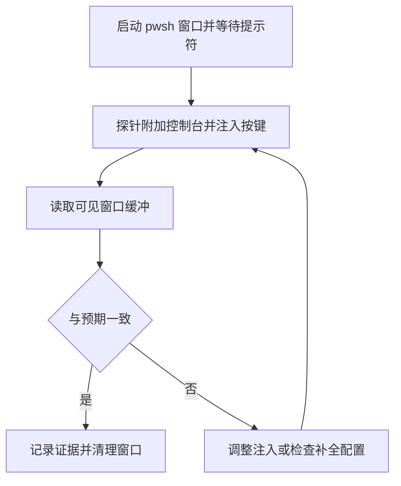

# 交互式控制台验证（模拟用户按键）

> 适用：需要在 Windows 上按用户视角复验交互式 shell 的界面行为（Tab 补全、参数菜单、预测视图），目标为 pwsh/PSReadLine 或 Git Bash 的 bash 时。需要可交互桌面会话；只验补全候选、不关心界面时可改用 `CommandCompletion::CompleteInput`（见 [argc-completions 部署与更新](Argc-Completions-Deploy.md) 的验收一节）。
> 本文给出从启动窗口到读屏取证的完整流程、探针脚本与常见失败；实测环境为 pwsh 7.5.4、PSReadLine 2.3.6、nginx 1.25.2。

## 适用范围与前提

- 目标是验证"用户按下 Tab 后实际看到什么"，包括菜单排序、描述列、选中后的缓冲变化；这些都无法由非交互的 `CompleteInput` 完整复现。
- 需要交互式桌面：`[Environment]::UserInteractive` 为 `True`，且进程运行在用户会话中。纯服务会话没有可用的控制台窗口，本流程不适用。
- 普通按键不依赖前台焦点：通过 `WriteConsoleInputW` 直接写入目标控制台输入缓冲区，不需要 `SendKeys` 或 `AppActivate`。真实 Ctrl+C 例外，需要前台焦点，见「真实按键验证 Ctrl+C」。新窗口会出现在当前桌面，显示期间可能短暂获得焦点，验证结束应立即关闭。
- 只在测试窗口内操作；不要对用户正在使用的终端注入按键。

## 原理

启动一个独立的交互式 pwsh 进程，让它加载 profile 到达提示符；由另一个探针进程附加到它的控制台，写入按键事件并读取屏幕缓冲区。普通字符、Tab、Esc 等注入事件与真实按键一致，PSReadLine 会执行相同的补全、菜单与重绘逻辑。目标换成 Git Bash 的 bash 时探针代码不变，差异只在启动方式与补全判读，见「非 PowerShell 控制台（Git Bash / MSYS）」。

**Ctrl+C 是例外**：探针用 `WriteConsoleInputW` 写入的是按键记录，而真实 Ctrl+C 在默认控制台模式下会被控制台当作控制事件处理。两者在 Tab 菜单中的表现不同，验证 Ctrl+C 必须用真实按键注入（见「真实按键验证 Ctrl+C」），不能拿探针的 `CtrlC` 结果推断真实行为。



图中的循环对应排障过程：先确认注入机制在对照命令上有效，再对目标命令重复；不一致时先排除注入问题，再怀疑补全配置。

## 启动窗口

```powershell
$lab = Join-Path $env:TEMP 'pwsh-console-lab'
New-Item -ItemType Directory -Force -Path $lab | Out-Null

$child = Start-Process pwsh -ArgumentList '-NoLogo', '-NoExit', '-Command', "`$Host.UI.RawUI.WindowTitle = 'CONSOLE-LAB'" -PassThru
$child.Id | Set-Content -LiteralPath (Join-Path $lab 'child.pid') -Encoding ascii
```

判据：读屏出现提示符才表示窗口就绪，不能用 `MainWindowHandle` 判断——实测目标进程与它的 `conhost` 子进程都为 0 时仍能附加并读屏，窗口矩形也可能为零；Windows Terminal 承载时窗口归终端进程，shell 进程通常一直为 0。`-NoExit` 让命令行执行完后停在提示符，`-Command` 只用于设置窗口标题（需要截图时用它定位窗口）；不要加 `-NoProfile`，否则验证的不是用户日常环境。

Profile 初始化耗时因机器而异。固定等待只用于首次试探；先用探针读屏确认提示符出现再注入，profile 较慢时延长等待，超时按失败处理，不用固定等待掩盖问题。

## 探针脚本

把以下脚本保存为 `$lab\Console-Probe.ps1`（`$lab` 见上一节）。它附加到目标进程的控制台，注入文本、发送单个按键、等待重绘后把可见窗口内容写入文件。

```powershell
[CmdletBinding()]
param(
    [Parameter(Mandatory)][int]$TargetPid,
    [string]$Text,
    [ValidateSet('None', 'Tab', 'Enter', 'Esc', 'CtrlC', 'ShiftTab')][string]$Key = 'None',
    [string]$Dump,
    [int]$WaitMs = 900,
    [int]$CharDelayMs = 50
)

$src = @'
using System;
using System.Text;
using System.Runtime.InteropServices;

public static class ConLab
{
    const uint GENERIC_READ = 0x80000000;
    const uint GENERIC_WRITE = 0x40000000;
    const uint FILE_SHARE_READ = 1;
    const uint FILE_SHARE_WRITE = 2;
    const uint OPEN_EXISTING = 3;

    [StructLayout(LayoutKind.Sequential)]
    public struct COORD { public short X; public short Y; }

    [StructLayout(LayoutKind.Sequential)]
    public struct SMALL_RECT { public short Left; public short Top; public short Right; public short Bottom; }

    [StructLayout(LayoutKind.Sequential)]
    public struct CONSOLE_SCREEN_BUFFER_INFO
    {
        public COORD dwSize;
        public COORD dwCursorPosition;
        public ushort wAttributes;
        public SMALL_RECT srWindow;
        public COORD dwMaximumWindowSize;
    }

    [StructLayout(LayoutKind.Sequential)]
    public struct KEY_EVENT_RECORD
    {
        public int bKeyDown;
        public ushort wRepeatCount;
        public ushort wVirtualKeyCode;
        public ushort wVirtualScanCode;
        public char UnicodeChar;
        public uint dwControlKeyState;
    }

    [StructLayout(LayoutKind.Explicit)]
    public struct INPUT_RECORD
    {
        [FieldOffset(0)] public ushort EventType;
        [FieldOffset(4)] public KEY_EVENT_RECORD KeyEvent;
    }

    [DllImport("kernel32.dll", SetLastError = true)] public static extern bool FreeConsole();
    [DllImport("kernel32.dll", SetLastError = true)] public static extern bool AttachConsole(uint dwProcessId);
    [DllImport("kernel32.dll", SetLastError = true, CharSet = CharSet.Unicode)]
    public static extern IntPtr CreateFileW(string name, uint access, uint share, IntPtr sec, uint disp, uint flags, IntPtr tmpl);
    [DllImport("kernel32.dll", SetLastError = true)]
    public static extern bool GetConsoleScreenBufferInfo(IntPtr h, out CONSOLE_SCREEN_BUFFER_INFO info);
    [DllImport("kernel32.dll", SetLastError = true, CharSet = CharSet.Unicode)]
    public static extern bool ReadConsoleOutputCharacterW(IntPtr h, StringBuilder buf, uint len, COORD coord, out uint read);
    [DllImport("kernel32.dll", SetLastError = true)]
    public static extern bool WriteConsoleInputW(IntPtr h, INPUT_RECORD[] buf, uint len, out uint written);
    [DllImport("user32.dll")] public static extern short VkKeyScanW(char ch);
    [DllImport("user32.dll")] public static extern uint MapVirtualKeyW(uint code, uint mapType);

    public static IntPtr In;
    public static IntPtr Out;

    public static void Attach(int pid)
    {
        FreeConsole();
        if (!AttachConsole((uint)pid)) throw new Exception("AttachConsole failed: " + Marshal.GetLastWin32Error());
        In = CreateFileW("CONIN$", GENERIC_READ | GENERIC_WRITE, FILE_SHARE_READ | FILE_SHARE_WRITE, IntPtr.Zero, OPEN_EXISTING, 0, IntPtr.Zero);
        Out = CreateFileW("CONOUT$", GENERIC_READ | GENERIC_WRITE, FILE_SHARE_READ | FILE_SHARE_WRITE, IntPtr.Zero, OPEN_EXISTING, 0, IntPtr.Zero);
        if (In == new IntPtr(-1) || Out == new IntPtr(-1)) throw new Exception("CONIN$/CONOUT$ open failed: " + Marshal.GetLastWin32Error());
    }

    static INPUT_RECORD Key(ushort vk, char ch, bool down, uint ctrl)
    {
        INPUT_RECORD r = new INPUT_RECORD();
        r.EventType = 1;
        r.KeyEvent.bKeyDown = down ? 1 : 0;
        r.KeyEvent.wRepeatCount = 1;
        r.KeyEvent.wVirtualKeyCode = vk;
        r.KeyEvent.wVirtualScanCode = (ushort)MapVirtualKeyW(vk, 0);
        r.KeyEvent.UnicodeChar = ch;
        r.KeyEvent.dwControlKeyState = ctrl;
        return r;
    }

    public static void TypeText(string s)
    {
        foreach (char ch in s)
        {
            short vk = VkKeyScanW(ch);
            ushort key = (ushort)(vk & 0xff);
            uint ctrl = 0;
            if ((vk & 0x100) != 0) ctrl |= 0x0010;   // SHIFT_PRESSED
            if ((vk & 0x200) != 0) ctrl |= 0x0008;   // LEFT_CTRL_PRESSED
            if ((vk & 0x400) != 0) ctrl |= 0x0002;   // LEFT_ALT_PRESSED
            INPUT_RECORD[] recs = new INPUT_RECORD[] { Key(key, ch, true, ctrl), Key(key, ch, false, ctrl) };
            uint w;
            if (!WriteConsoleInputW(In, recs, 2, out w)) throw new Exception("write text failed: " + Marshal.GetLastWin32Error());
        }
    }

    public static void TypeTextSlow(string s, int delayMs)
    {
        foreach (char ch in s)
        {
            TypeText(ch.ToString());
            if (delayMs > 0) System.Threading.Thread.Sleep(delayMs);
        }
    }

    public static void SendKey(string name)
    {
        INPUT_RECORD[] recs = null;
        if (name == "Tab") recs = new INPUT_RECORD[] { Key(0x09, '\t', true, 0), Key(0x09, '\t', false, 0) };
        else if (name == "ShiftTab") recs = new INPUT_RECORD[] { Key(0x09, '\t', true, 0x0010), Key(0x09, '\t', false, 0x0010) };
        else if (name == "Enter") recs = new INPUT_RECORD[] { Key(0x0D, '\r', true, 0), Key(0x0D, '\r', false, 0) };
        else if (name == "Esc") recs = new INPUT_RECORD[] { Key(0x1B, (char)0x1B, true, 0), Key(0x1B, (char)0x1B, false, 0) };
        else if (name == "CtrlC")
        {
            recs = new INPUT_RECORD[] {
                Key(0x11, '\0', true, 0x0008),
                Key(0x43, '\x03', true, 0x0008),
                Key(0x43, '\x03', false, 0x0008),
                Key(0x11, '\0', false, 0)
            };
        }
        if (recs == null) return;
        uint w;
        if (!WriteConsoleInputW(In, recs, (uint)recs.Length, out w)) throw new Exception("write key failed: " + Marshal.GetLastWin32Error());
    }

    public static string Dump()
    {
        CONSOLE_SCREEN_BUFFER_INFO info;
        if (!GetConsoleScreenBufferInfo(Out, out info)) throw new Exception("GetConsoleScreenBufferInfo failed: " + Marshal.GetLastWin32Error());
        int width = info.dwSize.X;
        int top = info.srWindow.Top;
        int bottom = info.srWindow.Bottom;
        StringBuilder all = new StringBuilder();
        all.AppendLine(string.Format("== window {0}x{1} cursor=({2},{3}) ==", width, bottom - top + 1, info.dwCursorPosition.X, info.dwCursorPosition.Y));
        for (int y = top; y <= bottom; y++)
        {
            StringBuilder sb = new StringBuilder(width + 1);
            uint read;
            if (!ReadConsoleOutputCharacterW(Out, sb, (uint)width, new COORD { X = 0, Y = (short)y }, out read))
                throw new Exception("ReadConsoleOutputCharacter failed at row " + y + ": " + Marshal.GetLastWin32Error());
            all.AppendLine(string.Format("{0,3}|{1}", y, sb.ToString().TrimEnd()));
        }
        return all.ToString();
    }
}
'@

Add-Type -TypeDefinition $src -Language CSharp

[ConLab]::Attach($TargetPid)
try {
    if ($Text) {
        if ($CharDelayMs -gt 0) { [ConLab]::TypeTextSlow($Text, $CharDelayMs) } else { [ConLab]::TypeText($Text) }
    }
    if ($Key -ne 'None') { [ConLab]::SendKey($Key) }
    Start-Sleep -Milliseconds $WaitMs
    if ($Dump) {
        [IO.File]::WriteAllText($Dump, [ConLab]::Dump(), (New-Object Text.UTF8Encoding $false))
    }
}
finally {
    [void][ConLab]::FreeConsole()
}
```

## 执行验证

以对照命令开头，确认注入链路有效，再测目标命令。以下命令在同一个窗口内顺序执行；每一步都读出屏幕文件后判读，不要盲目连按。

```powershell
$lab = Join-Path $env:TEMP 'pwsh-console-lab'
$probe = Join-Path $lab 'Console-Probe.ps1'
$id = [int](Get-Content -LiteralPath (Join-Path $lab 'child.pid'))

# 基线：确认提示符已就绪
& pwsh -NoProfile -File $probe -TargetPid $id -Dump (Join-Path $lab 'baseline.txt')

# 对照：已知命令的 Tab 补全
& pwsh -NoProfile -File $probe -TargetPid $id -Text 'Get-Chi' -Key Tab -WaitMs 1500 -Dump (Join-Path $lab 'control.txt')

# 清行（合成按键）：菜单打开时先 Esc 关闭菜单，再 Ctrl+C；真实按键的 Ctrl+C 行为见下文
& pwsh -NoProfile -File $probe -TargetPid $id -Key Esc -WaitMs 300 -Dump (Join-Path $lab 'after-esc.txt')
& pwsh -NoProfile -File $probe -TargetPid $id -Key CtrlC -WaitMs 500 -Dump (Join-Path $lab 'after-ctrlc.txt')

# 目标：待验证的参数补全
& pwsh -NoProfile -File $probe -TargetPid $id -Text 'nginx -' -Key Tab -WaitMs 3000 -Dump (Join-Path $lab 'target.txt')

Get-Content -LiteralPath (Join-Path $lab 'control.txt') -Encoding UTF8 | Select-Object -First 12
Get-Content -LiteralPath (Join-Path $lab 'target.txt') -Encoding UTF8 | Select-Object -First 24
```

清理窗口：

```powershell
& pwsh -NoProfile -File $probe -TargetPid $id -Key Esc -WaitMs 300
& pwsh -NoProfile -File $probe -TargetPid $id -Key CtrlC -WaitMs 300
& pwsh -NoProfile -File $probe -TargetPid $id -Text 'exit' -Key Enter -WaitMs 1200
Start-Sleep -Milliseconds 800
if (Get-Process -Id $id -ErrorAction SilentlyContinue) { Stop-Process -Id $id -Force }
```

## 非 PowerShell 控制台（Git Bash / MSYS）

同一套附加、注入与读屏方法也适用于 Git Bash 的 bash 进程，但启动目标与判读规则有差异：

- 先确认补全归属：在目标窗口执行 `complete -p <命令>`，或 source 仓库的 `bash/completion-diagnose.sh`；看注册函数是 `_carapace_completer*` 还是 `_argc_completer`。在补全框架安装前启动的终端仍用旧注册，需 `source` rc 或新开窗口。归属、顺序与取舍见 [bash/README.md](../../bash/README.md)。

- 目标必须是持有真实控制台的进程。`git-bash.exe` / mintty 使用自建终端窗口，`AttachConsole` 附加不上，也读不到屏幕；改用 Git 安装目录下的 `bin\bash.exe`，或在 Windows Terminal 里启动 bash。
- `bin\bash.exe` 可能只是启动器，真正接管的交互 shell 是它的 `usr\bin\bash.exe` 子进程。附加前按 `ParentProcessId` 找到子 bash，或附加到持有 `conhost` 的进程；只附加启动器时读不到提示符，现象与"窗口未就绪"相同。
- 从 `usr\bin\bash.exe` 直接启动时，`/usr/bin`、`/mingw64/bin` 可能没有进入 PATH，补全函数依赖的 `xargs` 等命令不可用，表现为候选静默为空。先 `command -v xargs` 验证，或从正常入口启动。
- bash 的可编程补全在多个候选时，第一次 Tab 只补公共前缀或响铃，第二次才列出候选；候选数超过 `completion-query-items` 时先询问 `Display all ...? (y or n)`。不要以一次 Tab 没有列表判定补全失效。
- 清理方式与 PowerShell 相同：输入 `exit` 退出，进程仍在时按记录的 pid 结束；bash 退出后 Windows Terminal 窗口可能保留，需要按自己的 pid 关闭并复查。

合成按键的 `Ctrl+C` 在 bash 下未实测：与 PSReadLine 一样，控制台可能把它当控制事件处理，不代表真实中断。需要验证中断行为时按下一节改用真实按键，并记录宿主与 bash 版本。

本节按既有探针的适用范围整理，仓库内尚无 Git Bash 下的实测记录；验证后按「实测记录」补环境版本与结论，并注明宿主是 conhost 还是 Windows Terminal。

## 真实按键验证 Ctrl+C

`WriteConsoleInputW` 的 `CtrlC` 会绕过控制台对 Ctrl+C 的处理，结果不能代表真实键盘。验证菜单中的 Ctrl+C 时，把目标窗口切到前台后用 `keybd_event` 发送，并校验 `GetForegroundWindow()` 与目标窗口一致；焦点不对时直接中止，避免把按键打进用户正在使用的终端。

```powershell
# Real-Key.ps1
param(
    [Parameter(Mandatory)][int]$Hwnd,
    [ValidateSet('CtrlC', 'Esc')][string]$Key = 'CtrlC'
)

$src = @'
using System;
using System.Runtime.InteropServices;

public static class RealKey
{
    [DllImport("user32.dll")] public static extern bool ShowWindow(IntPtr h, int n);
    [DllImport("user32.dll")] public static extern bool BringWindowToTop(IntPtr h);
    [DllImport("user32.dll")] public static extern bool SetForegroundWindow(IntPtr h);
    [DllImport("user32.dll")] public static extern IntPtr GetForegroundWindow();
    [DllImport("user32.dll")] public static extern void keybd_event(byte vk, byte scan, uint flags, UIntPtr extra);

    public static string Focus(IntPtr h)
    {
        ShowWindow(h, 9);
        BringWindowToTop(h);
        SetForegroundWindow(h);
        return "fg=" + GetForegroundWindow() + " target=" + h;
    }

    public static void SendCtrlC()
    {
        keybd_event(0x11, 0, 0, UIntPtr.Zero);
        keybd_event(0x43, 0, 0, UIntPtr.Zero);
        keybd_event(0x43, 0, 2, UIntPtr.Zero);
        keybd_event(0x11, 0, 2, UIntPtr.Zero);
    }

    public static void SendEsc()
    {
        keybd_event(0x1B, 0, 0, UIntPtr.Zero);
        keybd_event(0x1B, 0, 2, UIntPtr.Zero);
    }
}
'@

Add-Type -TypeDefinition $src -Language CSharp
$h = [IntPtr]$Hwnd
[RealKey]::Focus($h)
Start-Sleep -Milliseconds 300
if ([RealKey]::GetForegroundWindow() -ne $h) { throw '目标窗口不在前台，已中止' }
if ($Key -eq 'CtrlC') { [RealKey]::SendCtrlC() } else { [RealKey]::SendEsc() }
```

Windows Terminal 可能拒绝 `SetForegroundWindow`。先用 `AttachThreadInput` 连接前台线程与目标线程，再 `BringWindowToTop`、`SetForegroundWindow`；或者直接对已在前台的目标窗口发送。不要用 `SendKeys` 代替：它同样受焦点和终端按键映射影响，且转义规则容易把 `+`、`^` 解释成修饰键。

实测结论：

- 默认控制台模式下，真实 Ctrl+C 在 Tab 菜单打开时不会关闭菜单，输入行也不变化；只把 `Ctrl+C` 绑到 `CancelLine` 同样无效，因为按键没有进入 PSReadLine 的菜单循环。
- `Esc` 会关闭菜单并恢复键入的原前缀；随后真实 Ctrl+C 取消整行。
- 若在 Tab/MenuComplete 包装里临时设置 `[Console]::TreatControlCAsInput = $true`，菜单期间 Ctrl+C 变成普通按键，再配合 `Ctrl+C -> CancelLine` 即可一次清行；pwsh 7（conhost/Windows Terminal）与 PowerShell 5.1（Windows Terminal）均已验证。

可选包装（只用于验证或临时会话；本仓库 Init 尚未内置）：

```powershell
Set-PSReadLineKeyHandler -Key 'Ctrl+c' -Function CancelLine
Set-PSReadLineKeyHandler -Key 'Tab' -ScriptBlock {
    $old = $null
    try { $old = [Console]::TreatControlCAsInput; [Console]::TreatControlCAsInput = $true } catch { }
    try { [Microsoft.PowerShell.PSConsoleReadLine]::MenuComplete() }
    finally { if ($null -ne $old) { try { [Console]::TreatControlCAsInput = $old } catch { } } }
}
```

- 菜单退出后 `MenuComplete` 返回，`finally` 恢复原控制台模式；命令执行期间 Ctrl+C 仍按原方式中断。
- 若 Tab 已换成 argc 桩，需要把桩里的三处 `MenuComplete()` 都换成同样的包装，否则 argc 生效时又会退回无响应。
- 代价是菜单显示期间（包括补全计算）Ctrl+C 变成普通按键；正常 Tab 计算在毫秒级，极慢的补全计算无法再用 Ctrl+C 中止。

## 可选截图

需要留存窗口外观时，用 `PrintWindow` 抓取窗口位图。把下面脚本保存为 `$lab\Capture-Window.ps1`。`pwsh` 7.5（.NET 9）下 `Add-Type` 引用 `System.Drawing` 会缺 `System.Private.Windows.Core`，应改用 Windows PowerShell 5.1 执行：

```powershell
param($Hwnd, $Out)

$src = @'
using System;
using System.Drawing;
using System.Drawing.Imaging;
using System.Runtime.InteropServices;

public static class Shot
{
    [StructLayout(LayoutKind.Sequential)] public struct RECT { public int Left, Top, Right, Bottom; }
    [DllImport("user32.dll")] public static extern bool GetWindowRect(IntPtr h, out RECT r);
    [DllImport("user32.dll")] public static extern bool PrintWindow(IntPtr h, IntPtr hdc, uint flags);

    public static string Capture(IntPtr hwnd, string path)
    {
        RECT r;
        if (!GetWindowRect(hwnd, out r)) return "GetWindowRect failed";
        int w = r.Right - r.Left, h = r.Bottom - r.Top;
        if (w <= 0 || h <= 0) return "bad size " + w + "x" + h;
        using (Bitmap bmp = new Bitmap(w, h, PixelFormat.Format32bppArgb))
        using (Graphics g = Graphics.FromImage(bmp))
        {
            IntPtr hdc = g.GetHdc();
            bool ok = PrintWindow(hwnd, hdc, 2);   // PW_RENDERFULLCONTENT
            g.ReleaseHdc(hdc);
            bmp.Save(path, ImageFormat.Png);
            return "PrintWindow=" + ok + " size=" + w + "x" + h;
        }
    }
}
'@

Add-Type -TypeDefinition $src -Language CSharp -ReferencedAssemblies System.Drawing
[Shot]::Capture([IntPtr][int64]$Hwnd, $Out)
```

```powershell
$hwnd = (Get-Process -Id $id).MainWindowHandle
& powershell.exe -NoProfile -ExecutionPolicy Bypass -File (Join-Path $lab 'Capture-Window.ps1') -Hwnd $hwnd -Out (Join-Path $lab 'menu.png')
```

`MainWindowHandle` 为 0 时（ConPTY 宿主，或 shell 进程本身没有窗口），按启动时设置的窗口标题找承载窗口：

```powershell
$hwnd = (Get-Process | Where-Object { $_.MainWindowTitle -eq 'CONSOLE-LAB' }).MainWindowHandle
```

仍为 0 时截图不可用，但读屏判读不受影响，按屏幕文本取证即可。

## 判读规则

- Tab 生效：输入行被替换为候选，并在下方列出候选菜单；带描述的项说明补全器返回了工具提示。按键未生效时输入行保持原样，只在末尾回显字符。
- 预测不等于补全：输入 `nginx -` 后、按 Tab 前，屏幕底部可能出现 `<History(3) CxxuArgcFlags(7)>` 一类的列表视图。那是 PSReadLine 预测（历史与插件），不是 Tab 的候选菜单；判读时以"输入行是否被替换 + 是否出现候选菜单"为准。
- 首个 Tab 的行为是 `MenuComplete`：用第一个候选替换当前词并展开菜单，光标停在公共前缀之后。再按一次 Tab 会在新词上重新补全，不保证在候选列表内循环；需要多候选时看第一次展开的菜单。
- 菜单打开时，真实 Ctrl+C 不会关闭菜单，也不会清行：默认控制台模式把它当控制事件，PSReadLine 菜单收不到。`Esc` 关闭菜单并恢复输入前缀，再按 `Ctrl+C` 才取消整行。只把 `Ctrl+C` 绑到 `CancelLine` 对菜单无效；探针合成的 `CtrlC` 会关闭菜单并保留候选，不能代表真实按键。
- 5.1 没有预测视图，只能验证 Tab 菜单；同一脚本在 5.1 窗口同样可用。

## 常见失败与处理

| 现象 | 原因 | 处理 |
|---|---|---|
| 输入 `Get-Chi` 显示成 `^Get-hi` 或整行被取消 | `dwControlKeyState` 常量写错，把 Shift 当成 Ctrl。`LEFT_CTRL_PRESSED` 是 `0x0008`，`SHIFT_PRESSED` 是 `0x0010` | 按本文脚本的常量映射修正；用大写字母做对照，正常应显示原字符 |
| 目标窗口的输入行被 `dumped -> ...` 之类文字覆盖 | 探针附加控制台后，PowerShell 宿主的成功流输出可能写进目标控制台 | 探针附加后保持静默，只把结果写入文件；不要在附加期间 `Write-Output` |
| 参数绑定报 `Pid` 为只读变量 | 参数名 `Pid` 与自动变量 `$PID` 冲突 | 改用 `TargetPid` 等名称 |
| `Add-Type` 报缺少 `System.Private.Windows.Core` | pwsh 7.5 基于 .NET 9，`System.Drawing` 需要额外程序集 | 截图脚本改用 `powershell.exe` 5.1，并加 `-ReferencedAssemblies System.Drawing` |
| 截图为空白或只有标题栏 | 窗口被遮挡或未完成绘制 | `PrintWindow` 使用 `PW_RENDERFULLCONTENT`（`flags=2`），并确保窗口已重绘后再抓取 |
| 读屏行尾出现乱码字符 | 缓冲区未使用单元格保留旧内容 | 按可见窗口逐行读取并 `TrimEnd()`；不要用整块缓冲区内容判断 |
| 菜单打开时 Ctrl+C 没反应（菜单不关） | 默认控制台模式把真实 Ctrl+C 当控制事件，PSReadLine 菜单收不到；只绑 `CancelLine` 不解决 | 先 `Esc` 关菜单再 `Ctrl+C`；要一次生效，在 Tab/MenuComplete 包装里临时开启 `[Console]::TreatControlCAsInput`（见 [Feature-Guide](Feature-Guide.md)）；不要用探针 `CtrlC` 的合成结果判断 |
| 附加失败 `AttachConsole failed` | 目标进程没有控制台，或探针本身仍附着其他控制台 | 用 `Start-Process` 启动独立窗口；探针先 `FreeConsole()` |
| 目标是 Git Bash 时附加失败 | `git-bash.exe` / mintty 自建终端，不是控制台进程 | 改用 `bin\bash.exe` 或 Windows Terminal 里的 bash，见「非 PowerShell 控制台（Git Bash / MSYS）」 |
| 附加 Git Bash 成功但读不到提示符 | `bin\bash.exe` 只是启动器，交互 shell 是它的 `usr\bin\bash.exe` 子进程 | 按 `ParentProcessId` 找子 bash，或附加持有 `conhost` 的进程 |
| bash 补全候选静默为空 | 从 `usr\bin\bash.exe` 直接启动，缺 `/usr/bin`、`/mingw64/bin`，`xargs` 等命令不可用 | 先 `command -v xargs`；或从正常入口启动 |
| bash 第一次 Tab 没有候选列表 | 可编程补全先补公共前缀或响铃；候选超过 `completion-query-items` 时先询问 | 再按一次 Tab；出现 `Display all ...? (y or n)` 时按 `y` |
| 窗口一直等不到提示符 | Profile 初始化较慢或报错 | 读屏确认；必要时先以 `-NoProfile` 对照，再恢复带 profile 的验证 |

## 实测记录

实测时间 2026-11-09，环境为 Windows 10.0.26200、pwsh 7.5.4、PSReadLine 2.3.6、nginx 1.25.2、argc-completions 仓库补全。

- 对照命令 `Get-Chi` + Tab：输入行变为 `Get-MemoryChipInfo`，菜单列出 16 个 `Get-*` 命令，确认注入与读屏链路有效。
- 目标命令 `nginx -` + Tab：输入行变为 `nginx -?`，菜单列出下列参数与描述，确认 argc 参数补全在真实窗口中生效。

| 候选 | 描述 | 候选 | 描述 |
|---|---|---|---|
| `-?` | this help | `-T` | test configuration, dump it and exit |
| `-h` | this help | `-q` | suppress non-error messages during configuration testing |
| `-v` | show version and exit | `-s` | send signal to a master process: stop, quit, reopen, reload |
| `-V` | show version and configure options then exit | `-p` | set prefix path (default: /usr/share/nginx/) |
| `-t` | test configuration and exit | `-c` | set configuration file (default: /etc/nginx/nginx.conf) |
| `-g` | set global directives out of configuration file | `-help` / `-version` | Print help / Print version |

- 同一窗口在输入 `nginx -` 后、按 Tab 前，底部已出现 `<History(3) CxxuArgcFlags(7)>` 的预测列表；按 Tab 后才出现带描述的候选菜单，可作为"预测与补全分开判读"的实例。
- 清理时执行 `Esc`、`Ctrl+C`、`exit` 后窗口正常退出，未残留 pwsh 或 conhost 进程。

2026-11-09 追加菜单中的 Ctrl+C 实测（pwsh 7.5.4 / PSReadLine 2.3.6，conhost 与 Windows Terminal；PowerShell 5.1 / PSReadLine 2.0.0，Windows Terminal）：

- 探针 `CtrlC`（`WriteConsoleInputW`）：第一次关闭菜单并保留当前候选，第二次才取消整行；与真实按键不一致。
- 真实 `Ctrl+C`（`keybd_event`）：菜单保持打开，输入行不变；单独绑定 `Ctrl+C -> CancelLine` 后仍然无反应。
- 真实 `Esc`：关闭菜单并恢复键入前缀；随后真实 `Ctrl+C` 取消整行（`...^C`，新提示符）。
- Tab 包装内临时设置 `[Console]::TreatControlCAsInput = $true` 并绑定 `Ctrl+C -> CancelLine`：一次 `Ctrl+C` 即显示 `Get-ChildItem^C` 并回到新提示符；7 的 conhost/Windows Terminal 与 5.1 的 Windows Terminal 均通过。
