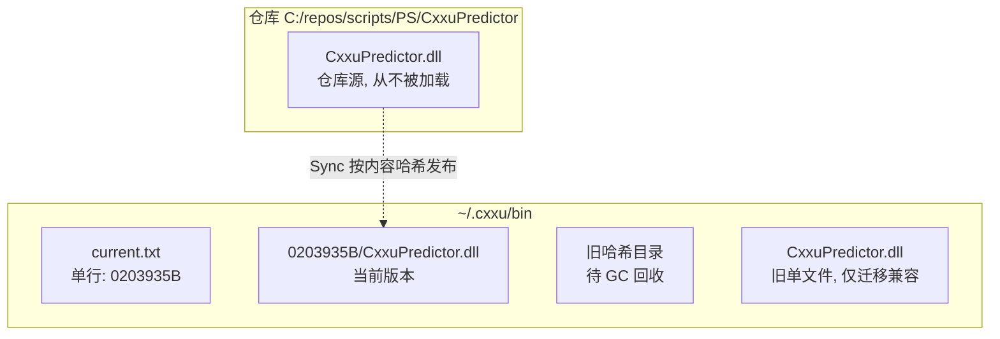
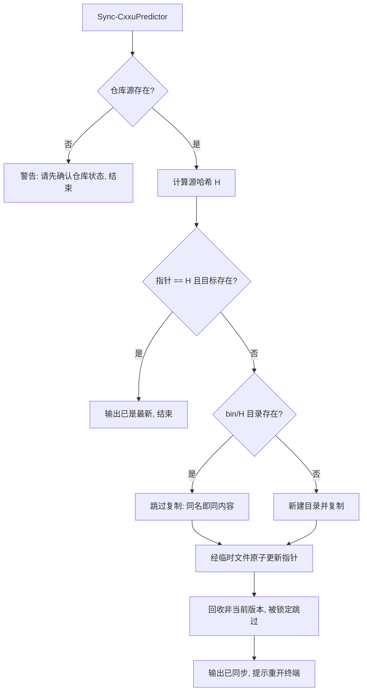
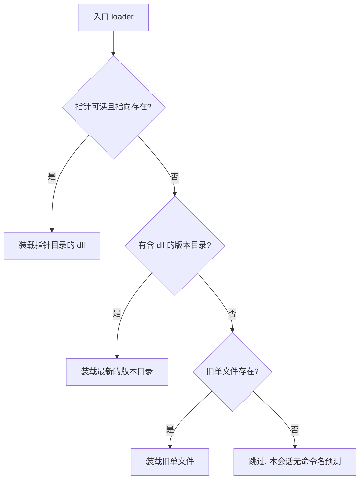
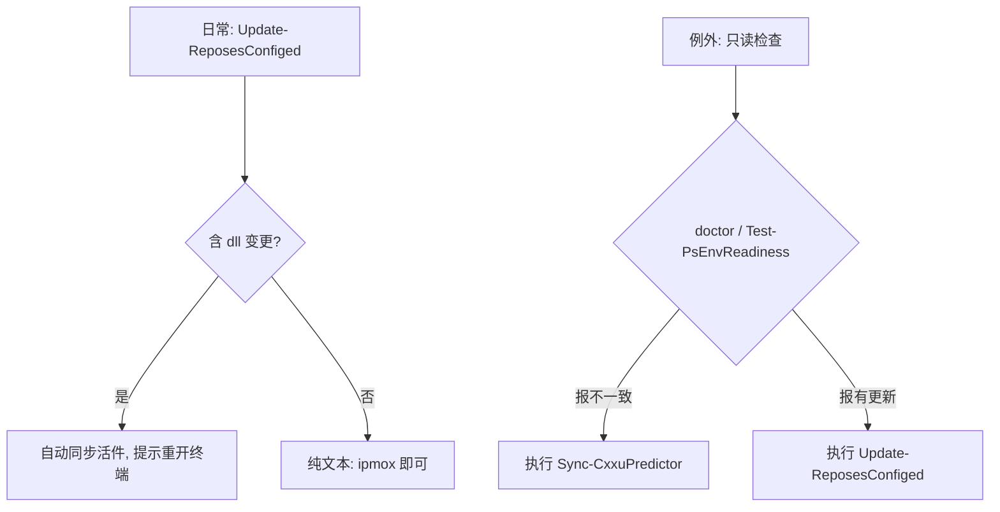

# 并排版本活件

> 本章讲 `CxxuPredictor` 的两套活件（net9.0 内联 predictor + 5.1 Tab-only）为什么按版本并排存放，以及各命令如何分工。术语（仓库源/活件/指针/自锁/他锁）以 `Module-Conventions.md §11` 为准。操作速查见 `Feature-Guide.md §9`，部署流程见 `Deploy-Guide.md §13`。

## 1. 背景

`CxxuPredictor` 必须编译成 `dll`（原因见 `Startup-Optimization.md §20`：PSReadLine 插件槽只接受 .NET 实现，且预测 20ms 预算纯 PowerShell 达不到）。 `dll` 一旦被会话加载，文件即被该进程锁定直到进程退出（.NET 程序集不随模块卸载而卸载，`Remove-Module` 后文件依然锁定，已实测）。

一个 dll 内含两个 predictor：`CxxuCommand`（命令名分层模糊）与 `CxxuArgcFlags`（argc 覆盖命令首参数位的静态 flag 提示）。flag 表缓存 `~/.cxxu/cache/argc-flags.tsv`，与 dll 版本独立；argc 补全脚本更新后首个会话自动重建（见 `Feature-Guide.md §10`）。

由此产生两个历史阶段：

- 仓库内加载：运行期直接加载仓库中的 `dll`，`git pull` 因文件锁定而失败，被迫配一整套清场逻辑（关闭其它会话、探测定锁、失败重试）。
- 外置单文件：活件搬到仓库外的固定路径，`git pull` 不再冲突；但同步仍是原地覆盖，只要有会话（包括执行同步的本会话）持有旧版，**复制必然失败**，并伴随入口警告刷屏。

结论：**只要更新语义是"覆盖旧文件"，锁就是不可消除的矛盾点**。并排版本把更新语义改为"发布新版本"，锁问题在结构上消失。

## 2. 目标与不变量

- 目标：同步操作在任何会话中执行都成功，不关闭任何会话，不输出警告。
- 不变量（一直成立，不因版本变化而改变）：
  1. **仓库源从不被加载**，因此版本推进（`git pull`）永远不受锁限制。
  2. 同步或删除完成后，当前会话内存中仍是旧代码，**必须重新打开终端**，再执行 `init`。
  3. 入口 loader **只静默装载**，不对比版本，不输出警告。

## 3. 静态结构



- 版本目录名是仓库源 SHA256 的前 8 位十六进制字符。同内容必同名，不同内容必不同名（哈希碰撞在 8 位截断下理论存在，实际构建频率下可忽略；即使碰撞，加载的仍是可用版本，只是可能不是最新，检查命令会报不一致）。
- 文件名在版本目录内恒为 `CxxuPredictor.dll`。**该约束不可放宽**：按路径导入时，模块名取文件名（不含扩展名），改名会导致 `Get-Module CxxuPredictor` 为空，全部检查逻辑失效（已实测踩坑）。
- 指针文件 `current.txt` 内容为单个目录名，无 BOM，无换行要求（读取时取首行并去空白）。

以上三条即指针协议的全部内容。图讲的是"东西放在哪"，下一节讲"怎么变过去"。

- 5.1 Tab-only 产物是第二套独立活件：仓库源 `PS/CxxuPredictor/ps51/CxxuPredictor.dll`，活件 `~/.cxxu/bin/ps51/<哈希>/CxxuPredictor.dll`，指针 `~/.cxxu/bin/ps51/current.txt`。它只保留 `CompleteCommand` 静态入口，不参与上面的 predictor 指针；原因、加载方式与构建见本章『5.1 Tab-only 产物』。

## 4. 同步流程



- 不受锁限制的形式化论证：
  1. 同步只执行两类写操作，一是新建目录并写入新文件（路径此前不存在，不可能被锁定），二是改写指针小文本文件（无进程长期持有）。
  2. 被锁定的旧版本文件从不触碰。**因此同步在任何会话中执行都成功**，无需关闭会话.  `-Force` 在同步路径上无意义（仅用于卸载路径保留，用于关闭其它会话）。
- 幂等：重复执行结果不变（第二次走"已是最新"分支），因此 `Update-ReposesConfiged` 可以无条件调用，无需预检。
- `-WhatIf` 显示将要新增的版本路径与指针目标，不执行写入。
- 两套产物各跑一次同样的流程；`ps51` 是根活件目录下的保留子目录，根目录回收旧版本时不会删除它。

## 5. 加载流程



- 旧会话继续使用装载时的旧版本，新会话使用指针指向的新版本。同一时刻存在多版本**是设计允许的状态，不是故障**。
- `CxxuTab`（Tab 插件）不经过模块装载，直接按字节读取指针指向的版本文件（不锁定文件，不注册 ListView 预测），因此与 `PsPredictor` 门独立，可单独启停（默认开，置 `$env:PsTab='False'` 关）。5.1 读 `ps51` 活件，7+ 读根活件，见本章『5.1 Tab-only 产物』。
- 指针损坏（空文件/指向不存在的目录）时自动降级，不报错；检查命令会报版本不一致，执行一次同步即恢复正常。

## 6. 回收与卸载

- 回收：每次同步后删除非当前版本的版本目录；被会话锁定的删除失败会被静默跳过，下次同步重试。旧单文件（迁移前产物）在无人持有时同样回收。
- 卸载（`Sync-CxxuPredictor -Uninstall`）：删除两套指针与全部版本目录（含 `ps51`）；被锁定的版本会逐个报告，请关闭持有会话后重新执行。卸载后若不禁用自动加载（持久化 `$env:PsPredictor='False'`；5.1 Tab 另加 `$env:PsTab='False'`），下次同步或更新会重新安装。

## 7. 故障模式

| 现象 | 原因 | 处理 |
|---|---|---|
| 检查报与仓库不一致 | 拉取了新版本但尚未同步 | 执行 `Sync-CxxuPredictor`（任何会话都可执行） |
| 指针损坏或丢失 | 文件损坏/误删 | 执行一次同步即重建；期间 loader 自动降级，不中断使用 |
| 旧版本目录长期存在 | 一直有会话持有旧版，GC 跳过 | 正常。持有会话全部退出后的下次同步会回收 |
| 同步后本会话仍是旧行为 | 不变量 2：内存中是旧代码 | **重新打开终端**，再执行 `init` |
| 卸载后又出现 | 未禁用自动加载 | 持久化 `$env:PsPredictor='False'`；5.1 Tab 另加 `$env:PsTab='False'` |
| 5.1 按 Tab 没有模糊候选 | `ps51` 活件未生成，或 CxxuTab 未导入 | 执行 `Sync-CxxuPredictor`，确认 `$env:PsTab` 没有被显式置 False，再重开终端；确认 `~/.cxxu/bin/ps51/current.txt` 指向的 dll 存在 |
| 5.1 能用 Tab 但没有内联预测 | 5.1 引擎没有预测子系统 | 正常；内联预测需 pwsh 7.2+，见本章『5.1 Tab-only 产物』 |

## 8. 命令分工：更新为什么不需要专用命令

曾有一个专用更新命令（fetch 判断、单仓库拉取、`-Force` 重开一条龙），2026-09-21 退役，原因：日常更新只用 `Update-ReposesConfiged`（批量拉取），它收尾已自动同步活件；专用命令的剩余价值（单仓库精确更新、一键重开）不足以支撑一个命令，手动等价操作足够（关闭会话、重新打开、`init`）。现行分工只剩两层，各管各的知识：

- `Update-ReposesConfiged` 理解 git（批量拉取）。它回答"仓库有没有新版本"，拉取后若 scripts 含 dll 变更，自动同步活件并提示重开终端。
- `Sync-CxxuPredictor` 不理解 git，只理解内容哈希：给定仓库源，发布或删除活件。它回答"活件与源是否一致"。无参数调用即完成判断与执行，且幂等。

两者是**调用关系，不是并列关系**：前者收尾调用后者。**合并成一个命令不可取**：合并体会同时背负 git 语义（分支、合并）与文件语义（哈希、指针、回收），调用者无法单独表达"我只想同步文件"（本地重编、手动修复、首次安装都不涉及 git）。

对用户的负担评估：**日常只需要记住一个入口**——`Update-ReposesConfiged`（批量更新，含自动同步）。例外情况由只读检查指路：`doctor`（统一诊断入口）与 `Test-PsEnvReadiness`（备注列与建议行）会明确写出下一步命令。`Sync-CxxuPredictor` 极少需要手工执行。



## 9. 参见

- 操作速查：`Feature-Guide.md §9`（检查/安装/更新/移除四件套）。
- 部署流程：`Deploy-Guide.md §13`。
- 现行决策：dll 外置到 `~/.cxxu/bin`，采用并排版本 + 指针；不要改回仓库内直接加载。
- 语言规范：`Module-Conventions.md §11`（术语）、§12（行文风格）。

## 10. 本地构建与自编译 dll（macOS / 新版 pwsh）

> 本节讲一件事：仓库源 dll 在你的 pwsh 上点不亮时，如何用本机 SMA 重编并发布为活件，全程不碰仓库源。

- 何时需要：仓库源 dll 随构建机 pwsh 的 SMA 版本而定；若在你的 pwsh 上加载失败（以 `Test-PsEnvReadiness` 表尾的仓库/pwsh/活件三行为准），或你的 pwsh 已新于仓库源覆盖的版本，走本地重编。Windows 本机一般不需要（构建机即 Windows）。
- 兼容范围：仓库源按 pwsh 7.5（net9.0）构建；pwsh 7.6 基于 .NET 10，可直接加载 net9.0 产物，不需要重编。pwsh 8 发布后先按本节验证，加载失败再重编。
- 前置条件：.NET 9 SDK（`dotnet --list-sdks` 须见到 9.x；若只有新版 SDK，net9 目标包需联网还原一次）；本机 SMA 路径为 `$PSHOME/System.Management.Automation.dll`（pwsh 内执行 `$PSHOME` 即得，macOS 如 `/usr/local/microsoft/powershell/7/...`）。
- 构建（产物进 `src/bin`，已 gitignore，不污染仓库）：
```powershell
cd PS/CxxuPredictor/src
dotnet build -c Release -p:SmaPath="$PSHOME/System.Management.Automation.dll"
# 5.1 Tab-only（仅 Windows；引用 5.1 的 GAC SMA，可用 -p:SmaPathPs51=... 覆盖）
dotnet build -c Release -f netstandard2.0 -p:SmaPathPs51="C:\WINDOWS\Microsoft.Net\assembly\GAC_MSIL\System.Management.Automation\v4.0_3.0.0.0__31bf3856ad364e35\System.Management.Automation.dll"
```
- `csproj` 的 SMA 引用已改为 `$(SmaPath)` 属性（默认 Windows 本机路径，不传参行为不变，Windows 回归已验）；`-p:SmaPath=` 只影响本次构建，不写文件。
- 发布（不碰仓库源，按产物内容哈希建版本目录、更新指针、写 `local-build.txt` 标记，只记 `repo/local` 与哈希日期，不记路径）：
```powershell
Sync-CxxuPredictor -DllPath ./bin/Release/net9.0/CxxuPredictor.dll
# 5.1 Tab-only 单独发布（默认用仓库源 PS/CxxuPredictor/ps51/；本地重编时显式指定）
Sync-CxxuPredictor -Ps51DllPath ./bin/Release/netstandard2.0/CxxuPredictor.dll
```
- 验证：重开终端 → `init`；`Test-PsEnvReadiness` 活件行应显示 `自编译版本[哈希]`（不再误报与仓库不一致）；`doctor` predictor 行应显示已加载自编译版本；输入命令名应有预测浮现。5.1 Tab 另见本章『5.1 Tab-only 产物』的验收步骤。
- 与更新的关系：`Update-ReposesConfiged` 检测到自编译标记会保持活件不动并提示（不会把可用活件换回仓库源）；想跟进仓库源时，重编后重新 `Sync-CxxuPredictor -DllPath`，或裸 `Sync-CxxuPredictor` 直接切回仓库源。
- 回退与停用：切回仓库源用裸 `Sync-CxxuPredictor`；彻底不用走 §6 卸载 + 持久化 `$env:PsPredictor='False'`。
- 警告：不要把本机构建覆盖提交为共享 `CxxuPredictor.dll`（仓库源面向多机多版本，跨 SMA 版本互相点不亮的风险见 `csproj` 头注；共享 dll 的更新须在多版本验证后单独提交）。
- 故障：`CS1705` 多为 SDK/TFM 与 SMA 代际错配（回看 `csproj` 头注的 net8 不可行结论）；`找不到 SMA` 检查 `-p:SmaPath` 路径是否存在；构建成功但加载失败确认 pwsh 7.5+（7.6 可直接加载；更高版本以实际加载为准，`dotnet --list-runtimes` 可佐证运行时）。

## 11. 5.1 Tab-only 产物

> 5.1 的引擎只到 SMA 3.0，没有 `System.Management.Automation.Subsystem.Prediction`，`ICommandPredictor` 注册不了；装 .NET 9 也不能让 5.1 加载 net9 程序集（5.1 固定在 .NET Framework 4.8 CLR）。因此 5.1 只提供 Tab 补全，不提供内联预测。

- 仓库源：`PS/CxxuPredictor/ps51/CxxuPredictor.dll`，`netstandard2.0`，引用 5.1 的 GAC SMA；同一份 `CxxuPredictor.cs` 用 `PS51` 条件编译，去掉 `ICommandPredictor` 实现，只保留 `CompleteCommand`。
- 活件：`~/.cxxu/bin/ps51/<哈希>/CxxuPredictor.dll` + `ps51/current.txt`；`Sync-CxxuPredictor` 与 net9 产物一起发布，根目录回收时保留 `ps51` 子目录。自编译 net9 活件保持不动时，更新流程用 `Sync-CxxuPredictor -Ps51Only` 只同步这一套。
- 加载：`CxxuTab` 在 `$PSVersionTable.PSVersion.Major -lt 6` 时只读 `ps51` 指针；按字节 `Assembly.Load`，不锁定文件，不注册 predictor。7+ 仍读根活件。
- 启用：默认开（`$env:PsTab='False'` 关）；重开 5.1 终端后首个 Tab 才导入 CxxuTab 并读命令表缓存（命中时建表约 20ms，模块导入另计；缺失/过期时现建约 0.4s，24h 内最多一次；之后 1ms 级）。
- 验收：5.1 中输入 `get-chi` 按 Tab，候选里应出现 `Get-ChildItem` 等模糊结果；`Get-Module CxxuTab` 应有模块；`~/.cxxu/bin/ps51/current.txt` 指向的 dll 应存在。
- 限制：只有 Tab 菜单，没有边输边弹的 ListView；后者需要 pwsh 7.2+（本仓库现成 net9 predictor 要求 7.5+）。
