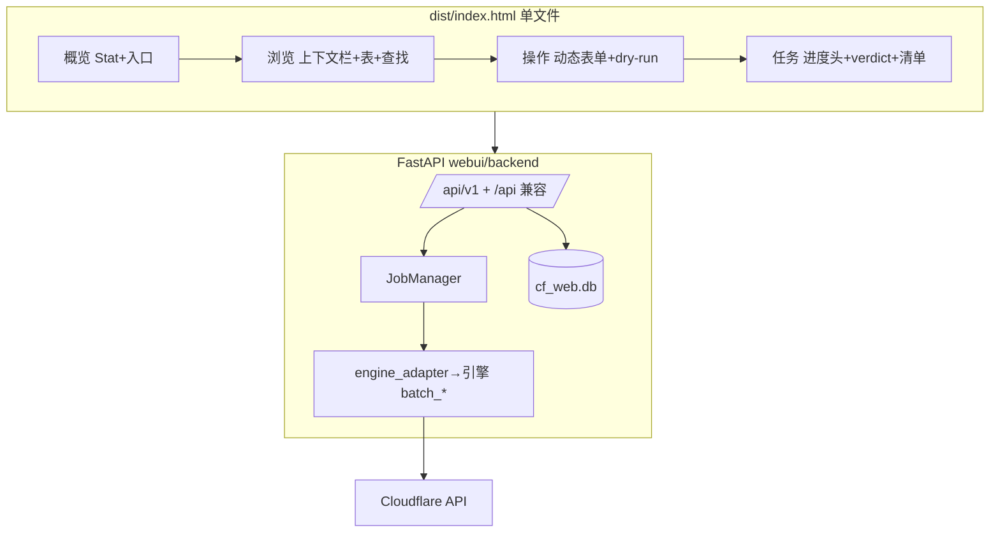

# WebUI 教训（单一前端已重建，历史保留）

旧 v1 四页前端已于 2026-11-16 移除：`webui/` 现为单一前端（后端 `webui/backend/` +
前端 `webui/v2/dist/`），本节保留历史教训，现状见第四节。

## 一、必须保留的后端设计

1. 引擎零侵入：`engine_adapter` 以 `importlib` 按路径加载 `cloudflare_dns_tool.py`；
   引擎内 `sys.exit` 全部转为 `EngineError`，密钥经 `mask_secret` 脱敏后才返给界面。
2. 任务模型：`jobs.JobManager` 线程池执行，`threading.local` 绑定当前任务，
   `log_print` 打补丁分流一份到任务日志，同时保留控制台输出；取消走 `stop_event`，
   与 CLI 语义一致；结果集上限 `max_results=2000`，日志 `deque(maxlen=2000)`。
3. 三级进度：任务（账号完成数）→ 账号卡（`account_status`）→ 域名明细
  （`zone_order`/`zone_states`，`progress_cb` 回调上报 `done/error/cancelled`）。
   结论复用引擎 `build_final_verdict`，失败清单复用 `FAILURE_CSV_FIELDNAMES`。
4. 接口分层：`/api` 兼容旧端，`/api/v1` 为主接口；`Deps` 注入
  （`get_accounts/get_manager/get_password/get_proxy_pool`）保证可测试性。
5. 分页一律服务端：`_paginate` 上限 200/页；`records` 先全量取再过滤分页，
   大账号不再全量下发 JSON。日志增量拉取 `offset/limit`，SSE 用标准库
   `StreamingResponse` 实现，无新增依赖。
6. 安全铁律：默认仅监听 `127.0.0.1`，对外监听无口令拒绝启动；
   口令走 `X-Auth-Token`；错误映射 `404`（不存在）/`400`（参数）/`502`（引擎故障）。
   任务级代理仅驻内存，不落盘、不进审计与日志（审计只记数量与模式）。
7. 持久化：标准库 `sqlite3`（WAL），`jobs_history` 终态 `upsert`，
   `audit_log` 记录 `execute` 提交与单条增删改；库文件放账号配置同目录 `cf_web.db`。
8. 预设同源：`/api/meta` 下发 `SPEED_PRESETS`、默认值与快照/导出目录
   （派生自配置文件所在目录 `cf_backup`/`cf_export`），前端只读展示，档位解析不由前端算。
9. SPA 回退防穿越：`candidate.startswith(base + os.sep)` 校验，未命中回退 `index.html`。
10. 单条记录校验（与 Cloudflare 网页版对齐）：`RECORD_TYPES` 允许到 `TXT/MX/NS/CAA/SRV`；
    仅 `A/AAAA/CNAME` 可开代理；代理开时 `TTL` 锁定 `1`；`TTL` 仅 `1` 或 `60~86400`；
    `@` 展开为根域名，短名自动补 zone 后缀；`PATCH` 省略字段沿用原值。
11. 提交校验与 CLI 对齐（`validate_job_params`）：删除类必须限定范围
    （白名单或指定域名）；删域名必须填快照目录；添加模式必须有目标
    （新域名或指定域名首个）；`add_records` 服务端预检 `parse_add_record_spec`；
    上传重跑清单上限 2MB，存临时文件。

## 二、前端教训（重设计时取舍）

1. 双前端并行是主败因：v1/v2 行为需逐项对齐（双击填入、批量勾选、记录弹窗约束），
   维护成本翻倍。重设计只保留单一前端。
2. 可用交互（建议继承）：单上下文栏（账号+域名+搜索+类型快筛）+ 单页滚动
   （内层滚动仅限弹窗体与日志框）；账号库/域名库进弹窗，双击填入下一步，
   复选框跨页保留、“所选送操作页”去重追加；记录行双击填入操作页旧内容与类型；
   命令面板 `Ctrl+K`（拼音选词时回车不误触）；操作表单按模式动态字段，
   高级速度项收折叠区，`dry_run` 默认开；删域名二次确认须输入 `DELETE`。
3. 任务页：进度头 `sticky`（进度+取消/下载清单）；历史与审计明细走弹窗；
   结束显示 `verdict`，失败清单一键下载 CSV（含 BOM）。

## 三、重设计约束

- 后端路由与字段不随意改名；新增接口先加 `/api/v1`，旧 `/api` 保留兼容。
- 任何变更仍跑 `ReadMe.md`“代码质量检查”全套（Ruff、Pyright、py_compile、
  `git diff --check`）与 `python -m unittest cf_api.tests.test_cf_dns_reliability`。
- 重设计的新前端以上述后端契约为依据，单一前端，不再双轨。

## 四、重建记录（2026-10 单一前端已落地，本节与实现同步维护）

已实现单一前端 + 全部功能补齐，架构如下（与 `webui/README.md` 同源，改一处须同步另一处）：

补齐项：`resume-upload` 落盘、`find` 跨账号查找、单条 `PATCH/DELETE` 按 id、
provision 全流程（DNS/等激活/邮箱/SSL/安全/加速）、zones `status` 过滤、
`meta.proxy` 数量模式。契约增量见 `tests/test_webui_extra.py`，黄金
`tests/test_webui.py` 未动。

## 五、本轮改进（与实现同步）

- 接线修复：`-N`（`oNoSub→include_subdomains`）、添加代理/TTL/多值开关、通配符模式说明块。
- 下载链：`zones.csv`（5000 行上限）、任务 `exports` 列表与文件下载（目录白名单内）。
- provision：`create_zone` 开关、激活超时/间隔可调（非法 400）。
- 调参：高级区 `-W/-A/-i/-R/-B/-M` 留空按档位、填值覆盖钳制；`whitelist-upload` 等价 `-w`。
- 直觉：行内“填入”按钮（双击的键盘/触屏等价）、浏览加载态与行内错误盒、任务结果翻页、预览/执行徽标、一键重跑失败域。
- 未做（有意）：配置文件切换（任意路径读风险）、任务级代理（仍仅启动时全局，见启动参数）、
  日志文件 `-L`（任务日志+历史/审计覆盖查询场景）。

## 六、破而后立重设计（2026-10-11，frontend-design＋admin-console-design，与实现同步）

- 主张：清单式控制台范围→预览→证据；记忆点四段步骤条全页共享；减法删快捷入口重复分组与 Stat 抽样误导（首账号总数改抽样声明＋测量条件）。
- 令牌：`on-primary` 深色改黑字（7.84）、`text3` 加深（白底 5.61）、成功色回 `#0f7a3d`（soft 底 4.69）、圆角 4/8/12/full、阴影带主色相、动效 120/200/320；字号/间距/图标库不变。
- 交互：查询真禁用＋原因、提交随 dry-run 显示预览/执行、按钮动词＋对象、`.btn` 全带图标（含 toast 撤销与忙态）、列宽统一 sonnet（Home 最小/End 最大/Enter 恢复）、CmdK/查找拼音守卫、刷新保留旧数据、分页 session 可回退、批量删除对象名二次确认、弹窗双向过渡。
- 验收：静态提高版 `accept.py` 通过、scan 0 hits、浏览器 390/768/1440＋flow 通过零 pageerror、unittest 17/17、对比度 11 对全过；截图 TEMP 人眼确认（全景定结构，浮层视口截图）。
- 后端契约未动；`forbid_keywords.txt` 与 `tests/test_records_api.py` 的工作区改动非本轮范围，未纳入。

## 七、草稿与正式施工（2026-11-15）

- 设计草稿只用于确认布局、信息架构和交互方向，不是实现目标。草稿通常会省略或简化 skill 中的长期要求，正式施工必须按 skill 补齐全套状态与验收底线。
- 本轮反例：`drafts/draft-b.html` 只有顶栏折叠按钮和静态页脚；v2 按草稿落地时漏掉 fable 外壳的 Rail 悬停/键盘临时展开、页脚收起/展开、Esc、`[` 快捷键和覆盖式槽宽不变。这些项在 v1 的 `TASKS.md` 已有记录，v2 重写时没有回查。
- 施工前先列 skill 对照清单：外壳状态、时序、键盘/触屏、覆盖与点击稳定、验收脚本；草稿未覆盖的条目默认纳入，不因草稿没画就省略。
- 验收按 skill 补测：悬停/焦点 peek、Esc、页脚按钮、主内容几何不变、快捷键；只测草稿画出的按钮不算完成。

## 八、异步验证不能当同步配置（2026-11-16）

- Cloudflare Email Routing 的目标地址验证是账号级、异步、邮件送达的：添加地址只触发验证信，未点击前 routing rule 与 catch-all 都不生效。
- 旧 provision 的顺序是先补 MX/启用路由、再检查目标地址是否已验证；首次配置时 MX 已切到 Cloudflare 而 catch-all 未设，来信会被拒（Address does not exist）。WebUI 应把“先验证目标地址、再启用路由”作为主路径，并在 provision 表单提示未验证风险。
- 验收覆盖：未添加、待验证、已验证、验证后完成 catch-all、非 Cloudflare MX、zone 非 active，以及 Gmail 垃圾箱与测试信提示；只测“能提交”不算完成。

## 九、验收要覆盖“运行中的那一份”（2026-11-16）

- 现象：源码、`dist` 构建、后端契约测试都通过，浏览器里邮箱转发面板仍报“接口不存在”。`webui.log` 显示新接口 404，后端进程启动时间早于这批代码约 8 小时。
- 根因：前端 `dist` 每次请求从磁盘读取，刷新就是新界面；Python 进程启动时已加载旧路由，不重启不会更新。浏览器验收另起新进程，又用 Playwright 拦截全部 `/api/v1`，所以测不到“正在运行的进程过期”。
- 补强：`tests/test_webui_api_paths.py` 比对前端源码路径与后端 OpenAPI 路由表；`serve-webui.ps1 -Status` 和复用分支对比进程启动时间与后端源码修改时间；后端代码改动后执行 `-Restart`。
- 通用规则：UI 与后端分别更新（静态产物 + 常驻进程）时，验收必须确认运行中的进程版本，不能只凭新进程测试通过；UI 全量 mock 时，另设前端路径与后端路由的静态契约，避免路径漂移被 mock 掩盖。

## 复选框右侧的小点：`text-overflow: ellipsis`（2026-11-16）

- 现象：DNS 表格每行复选框右侧有一个很小、颜色很淡的点，看起来像多余分隔符或残留元素。
- 根因：`.records-table td` 统一设置了 `text-overflow: ellipsis`；复选框单元格 38px 宽、左右各 9px 内边距，内容区只有 20px，而 `.checkbox-hit` 是 28px。内容溢出后在裁剪边缘绘制省略号，只露出第一个点。
- 修复：复选框列改为左右 5px 内边距（内容区正好 28px），并单独设置 `text-overflow: clip`；不要用 `overflow: visible`，否则会破坏表格列的裁剪与粘性列背景。
- 通用：给通用单元格加省略号时，固定宽度的勾选/图标/操作列要单独覆盖 `text-overflow`，并核对内容区宽度是否小于控件命中区。

## 主体区域居中（2026-11-16）

- 现象：宽屏下高级页内容贴侧栏左侧，右侧大片留白；工作台已居中，高级页没有。
- 根因：`.advanced-page` 只设了 `max-width: 1120px`，缺少 `margin: 0 auto`；1440 视口下可用主区刚好 1120，常规截图未暴露。
- 修复：与 `.workspace` 一致加水平 auto 外边距；`max-width` 保持 1120，不把表单页拉满。
- 通用：侧栏外壳的主内容容器只设 `max-width` 不等于居中，必须同时给 `margin-inline: auto`；验收至少补一个 1920 宽视口。

## 焦点环与激活描边需要预留间距（2026-11-16）

- 现象：代理设置弹窗里，输入框与上方列表项、右侧“添加”按钮贴得太近；侧栏“DNS 记录”激活后，底边描边与下一分组标题“高级工具”叠在一起（实测 0px）。两处都是点击或聚焦后才暴露。
- 根因：布局只按静态边距排，没有把 `:focus-visible` 的 `outline`（2px 环 + 2px 偏移 = 外扩 4px）和激活态 1px 描边计入占用；分组标题槽只有 18px，上下留白为 0/4px。
- 修复：交互控件之间与容器边框至少留 4px，推荐 6–8px；代理新增行改为 `margin-top: 8px`、`gap: 8px`，textarea 右内边距 16px 给原生缩放柄留位。同类一并处理：侧栏导航项 6px、表格行内操作 6px（操作列 126→132）、抽屉页签 8px、资源切换列表 6px。
- 分组标题：上方 12px、下方 8px（标题槽 32px），保证上一组激活项描边与下一组首项焦点环都不贴文字；rail 与 peek 共用同一槽高，rail 分隔线随槽高居中，避免展开时图标位移。
- 反向情况：贴着容器分隔线或滚动裁切区的控件（表格滚动区、抽屉页签、资源列表）改用负 `outline-offset`，把环画在内侧；表格滚动区焦点环改挂到 `.records-panel`，否则会被粘性表头与操作列遮住。
- 通用：写紧凑布局时按“控件边框 + 4px 焦点环 + 激活态描边”估算间隙；验收补键盘 Tab 与激活态截图，不能只看鼠标态。
