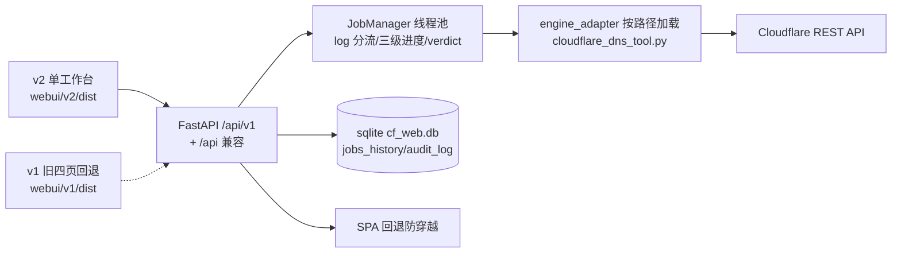
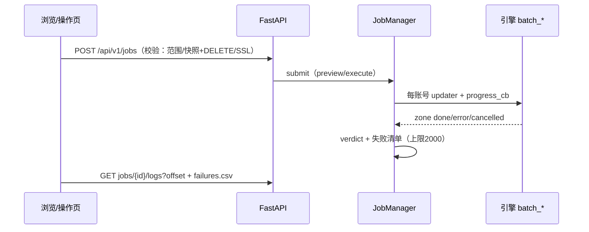

# WebUI（单一前端重建）

后端 `webui/backend/`，默认前端 `webui/v2/`（Vite + React + TypeScript，单工作台）；旧四页前端保留在 `webui/v1/`，可用 `--v1` 切回。

新前端源码与构建产物在 `webui/v2/`，默认入口即 v2；状态与功能对照见
[v2/README.md](v2/README.md) 与 [REDESIGN.md](REDESIGN.md)。

交互方案草稿见 [drafts/index.html](drafts/index.html)：三版静态 mock，不接后端。
已选定草稿 B（全局侧栏 + 顶栏资源切换 + 弹窗编辑 + 右侧批量抽屉）并在
`webui/v2/` 落地；草稿只确认布局与交互方向，正式实现按 `admin-console-design`
补齐外壳细节（默认展开、页脚收起/展开、Rail 悬停与键盘临时展开、Esc、`[`）。
A/C 保留供回退。

## 启动（后台，不占 shell）

```powershell
.\serve-webui.ps1                        # 启动 8600（Hidden 后台，shell 立即返回；已在跑则复用）
.\serve-webui.ps1 -Status                # 快查 8600（进程 PID + 端口探活 + meta）
.\serve-webui.ps1 -Restart               # 重启 8600（配置/绑定/代理保持现状，口令复用旧值或环境变量）
.\serve-webui.ps1 -Restart -Lan -Password <pwd>  # 重启并绑定 0.0.0.0 对外分享（无口令拒绝）
.\serve-webui.ps1 -Restart -NoLan        # 重启并切回仅本机
.\serve-webui.ps1 -Port 8601 -Status     # 查别的端口（Status/Stop/Restart 均可组合 -Port）
.\serve-webui.ps1 -Port 8601             # 在 8601 启动 v2（默认）
.\serve-webui.ps1 -Port 8601 -V1         # 在 8601 启动旧四页前端
.\serve-webui.ps1 -Restart -V1           # 重启并切到 v1；-V2 切回 v2
.\serve-webui.ps1 -Ports                 # 列出本机所有 WebUI 服务（只读）
.\serve-webui.ps1 -RestartAll            # 重启本机所有 WebUI 服务（逐个模式保持）
.\serve-webui.ps1 -Logs -Lines 100       # 看 webui.log 末尾（Hidden 启动排障全靠它）
.\serve-webui.ps1 -Stop                  # 停掉 8600 上的服务（按端口精确匹配）
```

- 对标 `frontend_design/serve-preview.ps1` 的管理模型：端口空闲直接拉起并等就绪反馈；
  已是本服务则复用；被别的程序占用则询问新端口（回车自动顺延）。
- 改了后端代码（`webui/backend/`、`start_web_ui.py`、`cloudflare_dns_tool.py`）后必须 `-Restart`；
  `-Status` 或复用已有服务时会对比代码修改时间与进程启动时间，可能过期时给出提示。
  前端 `dist` 每次请求从磁盘读取，重新构建后刷新页面即可，不必重启。
- 日志 `webui.log`（`--log-file` 追加，超 512KB 转 `.1` 备份，无 ANSI 着色）；Hidden 进程不保证跨会话存活，每次先 `-Status` 确认。
- 直接 `python start_web_ui.py` 仍可用（前台阻塞，仅调试用）；日常用 `serve-webui.ps1`。

## 前台启动（仅调试）

```bash
python start_web_ui.py --config <cf_config.csv|json> --port 8600
# 旧四页前端回退
python start_web_ui.py --v1 --config <cf_config.csv|json> --port 8600
# 对外监听必须设口令
python start_web_ui.py --host 0.0.0.0 --port 8600 --password <pwd>
```

- 默认仅监听 `127.0.0.1`；对外无口令拒绝启动。
- 口令走请求头 `X-Auth-Token`；前端记住到 `localStorage`。
- 全局代理仅驻内存：`-P URL` / `--proxy-file`，审计只记数量与模式。

## 架构





## 接口

- 主接口 `/api/v1`：`meta/accounts/zones(status|csv)/records(GET/POST/PATCH/DELETE/bulk-delete/bulk-update/bulk-restore/import/export)/email-routing(addresses|status|complete)/find?domain=/zones/activation-check/jobs/jobs/{id}[/logs|results|failures|anomalies|failures.csv|anomalies.csv|cancel|zones|exports|exports/{n}|rerun|execute]/resume-preview/resume-upload/whitelist-upload/history/audit`。
- 兼容旧端 `/api/meta`、`/api/accounts`。
- 分页一律服务端，上限 200/页；日志增量 `offset/limit`；失败清单 CSV 含 BOM。
- 持久化 `sqlite3`（WAL），库文件在配置同目录 `cf_web.db`；旧库缺列自动迁移。
- `meta` 下发 `SPEED_PRESETS`、默认值、快照/导出目录与代理数量模式，前端只读展示。

## 约束

- 引擎零侵入：`engine_adapter` 按路径加载 `cloudflare_dns_tool.py`，`sys.exit` 转 `EngineError`，密钥脱敏。
- 提交校验与 CLI 对齐：删除类限定范围，删域名需快照目录 + `DELETE` 确认，`add_records` 预检，清单 2MB 上限。
- 单条校验与网页版对齐：仅 A/AAAA/CNAME 可开代理，代理开时 TTL 锁定 1，TTL 仅 1 或 60~86400。
- 任务三级进度：任务 → 账号卡 → 域名明细（`progress_cb`），结论复用 `build_final_verdict`。
