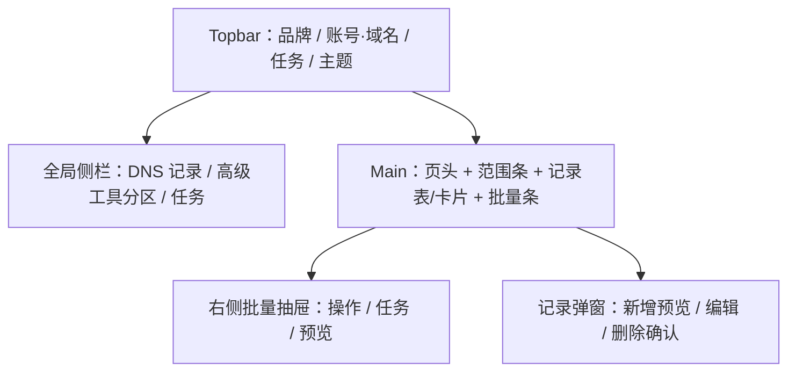

# WebUI 重设计（v2）方案

状态：v2 已作为默认入口。旧前端 `webui/v1/` 保留为回退，不在旧稿上继续打补丁。

## 1. 主张

一句话：**在一个工作台里完成“选账号/域名 → 看记录 → 圈选 → 预览差异 → 执行 → 处理失败”。**

记忆点：**Scope Ribbon（影响范围条）+ Diff Preview（变更差异预览）**。范围条始终显示本次会影响哪些账号、域名、记录；预览把 old → new 逐条列出，确认后才允许执行。

不做什么：

- 不做多用户、权限、对外监听；继续只服务本机单用户。
- 不做双前端并行；旧前端只作为回退，不参与新功能。
- 不把 CLI 的全部参数平铺到首屏；低频能力收进高级页或抽屉。
- 不虚构配额上限；没有接口就不显示伪造数字。
- 不用装饰性步骤条冒充流程；预览/执行是真实状态，不是四段导航。

## 2. 用户与任务

主用户：一个人维护多个 Cloudflare 账号、多个 zone，偶尔做批量变更。

主任务（首屏必须顺手）：

- 找到账号和域名，查看 DNS 记录。
- 批量更新 A/AAAA/CNAME 的内容（改 IP、迁移记录）。
- 清理旧记录：删除通配符、删除指向指定 IP 的记录、清空/删除域名。
- 看任务结果，下载失败清单，按原参数重跑。

次要任务：

- 添加域名/记录，设置代理与 TTL。
- 导入/导出记录，备份 zone。
- 跨账号查找域名。
- 查看历史与审计。

低频任务：

- `--provision` 全流程（DNS/激活/邮箱/SSL/安全/加速）。
- 白名单/重跑清单上传。
- 速率、重试、代理等运行参数。
- 原始任务日志与请求异常明细。

## 3. 信息架构

```text
Topbar 56
  品牌 / 账号·域名切换 / 本机与代理 / 任务 / 主题

Sidebar（桌面默认展开 264，页脚按钮收起为 Rail 64；Rail 悬停/键盘临时展开，
  覆盖式展开，主内容槽宽不变；窄屏 280 抽屉）
  DNS 记录
  高级工具
    跨账号查找 / 配置向导 / 邮箱转发 / 导入导出 / 范围附件 / 历史与审计 / 运行参数
  任务与日志

Main
  页头：DNS 记录 / 批量操作 / 新增记录
  范围条：域名、状态、记录数、选中数、附件、刷新
  记录工具栏：搜索 / 类型 / 代理 / 计数 / 导出
  记录表或窄屏卡片：选择 / 名称 / 类型 / 内容 / 代理 / TTL / 备注 / 编辑删除
  批量条：批量面板 / 改内容 / 按域名批量 / 代理 / 删除 / 清除

Batch Drawer 400（桌面推挤，窄屏模态）
  操作：选中清单 → 动作卡 → 参数 → 真实 Diff → 执行
  任务：任务列表 → 详情（进度/结论/失败/异常/导出/重跑/日志）

Record Modal
  新增记录（预览后执行）/ 编辑记录（PATCH）/ 删除确认（确认勾选）

Advanced（侧栏分区 + 独立路由）
  跨账号查找 / 配置向导 / 邮箱转发 / 导入导出 / 范围附件 / 历史与审计 / 运行参数
```



## 4. 关键交互

### 4.1 范围

- 默认范围 = 当前账号 + 当前域名 + 当前选中记录。
- 需要跨账号/跨域名时，显式打开“修改范围”：账号多选（带搜索）、域名多选、或粘贴域名/白名单。
- 范围条始终显示“将影响 N 个账号、M 个域名、K 条记录”；超出当前上下文时用警告色。
- 不再用“59 个账号 chip 全选”作为默认；账号多选必须有搜索、全不选、仅当前。

### 4.2 预览与执行

- 所有变更先提交 `dry_run=true` 预览任务。
- 预览完成展示：动作、范围、将更新/新增/删除的条数、示例 diff、风险提示。
- 只有预览通过后才出现“执行变更”；执行使用同一份参数，`dry_run=false`。
- 删除类必须二次确认：删除通配符/删除 IP 填对象摘要；删域名输入 `DELETE`，并要求快照目录。
- 预览任务与执行任务在任务中心成对展示，避免“预览完找不到原参数”。

### 4.3 任务中心

- 顶栏显示运行中任务数；点击打开右侧批量抽屉的“任务”页签。
- 任务列表：编号、模式、预览/执行、状态、范围摘要、时间、耗时。
- 任务详情：进度、账号/域名/记录计数、结论摘要、失败清单、请求异常、日志、导出文件。
- 动作：取消、执行此预览、重跑失败域名、按原参数重跑、下载失败 CSV、下载异常 CSV。
- 历史/审计只在 Advanced 以表格展示，不再把 JSON 塞进弹窗。

### 4.4 状态

- 每个异步区域有加载/空/错/成功四态；刷新保留旧数据并显示“刷新中”。
- 错误文案给出原因和下一步，不直接回显引擎原始 JSON；原始错误折叠进日志。
- 表格空态区分：无账号、无域名、无记录、无匹配、加载失败。
- 表格容器内滚动，页面不横滚；关键操作按钮始终可达。

## 5. 功能对照

| CLI / 现有能力 | 新位置 | 处理 |
|---|---|---|
| `--list-dns` / 浏览记录 | Workspace 记录表 | 保留，按总量分档：小 zone 全量本地、大 zone 服务端分页/过滤 |
| `--new-ip` / `--new-content` | 记录表选中 → 批量抽屉的更新表单 | 重做上下文与预览 |
| `--old-ip` / `--old-content` | 更新表单的旧内容过滤 | 保留 |
| `--record-type` | 更新表单 | 保留 |
| `--delete-wildcard\` | 批量抽屉动作卡 | 保留，强制预览 + 范围 |
| `--delete-ip` | 批量抽屉动作卡 | 保留，强制预览 + 范围 |
| `--delete-zone dns/full` | 批量抽屉危险区 | 保留，快照 + DELETE 确认 |
| `--add-domain` / `--add-record` | 记录弹窗新增 / 批量抽屉添加表单 / Advanced | 保留 |
| `--set-proxied` / `--set-ttl` | 批量条 + 批量抽屉 | 保留 |
| `--export json/bind` | Advanced 导出/备份 | 保留 |
| `--backup-dir` | 危险动作的必填项 | 保留 |
| `--provision` | Advanced 向导 | 保留，分步表单 |
| `-f/--find-domain` | Advanced 查找 | 重做为结果列表，不只显示数量 |
| `--list-zones` / `zones.csv` | 顶栏资源切换 + Advanced 导出 | 保留 |
| `--failed-output` | 任务详情下载 CSV | 保留 |
| `--resume-from` | 任务详情“重跑失败域名” / 上传清单 | 重做，恢复原参数 |
| `--retry-output` | 任务详情“请求异常”表 + CSV | 补后端缺口 |
| `--speed` / `-W/-A/-i/-R/-B/-M` | Advanced 运行参数 | 保留，默认折叠 |
| `-P/--proxy` / `--proxy-file` | 启动参数 + Advanced 只读展示 | 保留全局代理；任务级代理仍不做 |
| `-L/--log-file` | Advanced 原始日志 / 下载 | 保留任务日志；文件日志可选 |
| `-C/--config` | 启动参数 | 默认不在 UI 切换（安全），待确认 |

## 6. 后端：结构与缺口

### 6.1 当前结构

后端不是单文件，但确实存在一个集中点：

- `app.py` 约 1270 行：8 个 Pydantic 模型、约 70 个路由，以及鉴权、账号查找、分页、zone 解析、上传、CSV 下载、SPA 回退。所有路由都嵌套在 `create_app()` 内，单个 handler 最长超过 100 行。
- `jobs.py` 约 745 行：`Job` 数据模型、`JobManager`、线程池执行、日志分流、模式分发、provision 运行器混在一起。
- `engine_adapter.py`、`db.py`、`validate.py`、`deps.py` 都在 200 行以内，边界相对清楚。

结论：现在不是“所有后端在一个文件”，而是 `app.py` 承担了 HTTP 层、schema、部分业务逻辑和静态资源回退，职责过宽。重设计会新增 rerun、execute、anomalies、zone cache 等接口，如果继续往 `app.py` 里加，会很快超过 1500 行，测试和定位都会变差。

### 6.2 建议结构

按“HTTP 层 / 业务服务 / 任务执行 / 适配层”做中等粒度拆分，不做 DDD 或微服务：

```text
webui/backend/
  app.py                 # create_app：鉴权、include_router、SPA 回退
  deps.py                # 配置、口令、代理池、JobManager 注入
  schemas.py             # Pydantic 请求/响应模型
  errors.py              # 引擎/上游错误到 HTTP 的统一映射（可选）
  routers/
    meta.py              # /meta、/accounts
    zones.py             # /zones、/zones.csv、/zones/activation-check
    records.py           # 单条与批量记录、导入/恢复
    jobs.py              # 提交/列表/详情/日志/结果/失败/取消/重跑/异常
    uploads.py           # 白名单/重跑清单上传与预览
    history.py           # 历史/审计
  services/
    accounts.py          # 账号查找、脱敏
    zones.py             # zone 解析、短 TTL 缓存
    records.py           # 过滤/分页、批量写入编排
    jobs.py              # 提交、预览转执行、按原参数重跑
  jobs/
    models.py            # Job、snapshot、失败 CSV
    manager.py           # JobManager、线程池、取消
    runner.py            # run_operation_job、模式分发、provision
    progress.py          # 日志分流、进度回调
  engine_adapter.py      # 保持薄适配层
  db.py                  # 保持 sqlite 持久化
  validate.py            # 保持参数校验
```

拆分原则：

- 不改 URL、不改 JSON 字段；新接口只加 `/api/v1`，旧接口保持兼容。
- 迁移按路由组分批进行，每拆一组就跑现有契约测试；不一次性重写。
- `engine_adapter.py`、`db.py`、`validate.py` 不拆；它们是稳定边界。
- `jobs.py` 的拆分优先级低于 `app.py`：先拆路由和 schema；新增 rerun/anomalies 时再把 `JobManager` 与 runner 分开。
- 不为了“结构好看”引入 repository/service 全套抽象；只有被多个路由复用、或需要独立测试的逻辑才下沉到 `services/`。

### 6.3 后端缺口

重做前端时一并补齐，不重写引擎：

- `Job` 保存 `params`（脱敏）与 `dry_run`，`snapshot()` 暴露范围摘要；支持“执行此预览”和“按原参数重跑”。
- 收集每个账号的 `updater.request_anomalies()`，新增：
  - `GET /api/v1/jobs/{id}/anomalies`
  - `GET /api/v1/jobs/{id}/anomalies.csv`
- 新增 `POST /api/v1/jobs/{id}/rerun`：`failed_only` 可选，`dry_run` 可覆盖；校验沿用原参数。
- 新增 `POST /api/v1/jobs/{id}/execute`：仅预览任务可执行，等价于用原参数提交 `dry_run=false`。
- 新增结构化任务摘要：计数、Top 失败原因、可重跑/确定性错误分类；原始 verdict 仍保留在日志。
- `zones` 列表加短 TTL 缓存（建议 30 秒），创建/删除 zone 后失效；减少首屏重复请求。
- 历史/审计接口补分页/过滤（可选），前端用表格展示。
- 统一错误映射：400 参数、404 不存在、409 状态冲突、502 引擎/上游故障。

## 7. 技术栈与目录

- Vite + React + TypeScript。
- 路由：React Router；服务状态：TanStack Query；UI 状态：轻量 store/context。
- 组件：Radix UI（对话框/弹出层/Combobox）+ Lucide 图标；样式用 CSS 变量 + CSS Modules（或 Tailwind，按实现时依赖情况定）。
- 测试：Vitest + React Testing Library + Playwright。
- 开发目录：`webui/v2/`；构建产物 `webui/v2/dist/`。
- 迁移期：FastAPI 同时可服务旧 `v1/dist` 与新 `v2/dist`，默认 v2，`--v1` 回退。
- 旧前端保留在 `webui/v1/`，不删除、不继续加功能；回退只需切回入口。

## 8. 验收

功能：

- 59 个账号规模下，账号搜索、选择、域名加载可用；不出现整屏 chip。
- 浏览记录 → 选中 → 批量更新 → 预览 → 执行 → 任务结果 → 失败 CSV → 重跑，全链通过。
- 删除通配符/删除 IP/删域名：范围、预览、二次确认、备份目录生效。
- 添加记录、设置代理/TTL、导入/导出、provision 预览、find 结果列表、历史/审计可用。
- 请求异常表与 CSV 可见；任务预览可执行、失败可按原参数重跑。

质量：

- 1440 / 768 / 390 / 320：页面无横滚，表格容器内滚动，操作按钮可达。
- 深色/浅色主题、键盘导航、焦点可见、对比度 4.5:1（正文）/3:1（控件边界）。
- 加载/空/错/成功四态；请求失败有重试入口；无未处理 Promise。
- 后端契约测试全过；新增任务/重跑/异常测试；Playwright 覆盖关键路径。
- 真实账号只读冒烟需单独确认；合成实例验证写路径时只使用 dry-run。

## 9. 迁移与回滚

- 旧前端不删，新前端独立构建、独立入口。
- 先完成只读工作台，再接批量任务；每阶段可用旧入口回退。
- 切换默认入口前，逐项对照第 5 节功能表；未覆盖项不得声称完成。
- 保留 `webui/v1/` 与现有 `/api/v1` 契约；新增接口先加 `/api/v1`，旧接口不动。

## 10. 待确认

- 是否需要在 Web 内切换配置文件 `-C`？默认建议不做，保持启动参数。
- provision 是否必须首期进新前端，还是先留在旧前端/CLI？
- 真实账号只读验收是否授权；如授权，是否只跑 `GET /zones`、`GET /records`。
- 视觉方向：已选定草稿 B（全局侧栏 + 顶栏资源切换 + 弹窗编辑 + 右侧批量抽屉）；草稿只确认布局与交互方向，正式实现按 `admin-console-design` 的完整外壳状态补齐；未选草稿保留供回退。

## 11. 实施记录

- 后端结构拆分已落地：`app.py` 只保留应用组装与 SPA 回退；路由拆到 `routers/`，schema 拆到 `schemas.py`，账号/zone/记录/任务编排在 `services/`。现有 29 个契约测试通过。
- 任务模型已补 `params/speed/dry_run/anomalies`，新增 `anomalies`、`anomalies.csv`、`rerun`、`execute` 接口；zone 列表加 30 秒 TTL 缓存。
- `webui/v2/` 已建立 Vite + React + TypeScript 单工作台：页头与范围条、记录表、单条编辑弹窗、批量/任务右侧抽屉、高级页、窄屏卡片；支持 mock 模式与真实 `/api/v1`。
- 交互重构已按草稿 B 落地：顶栏账号/域名切换、全局侧栏、单条记录弹窗、批量操作/任务右侧抽屉；保留预览、删除确认、快照、失败 CSV 与审计。草稿 B 只画了顶栏折叠与静态页脚，正式实现已补回 fable 外壳的页脚收起/展开、Rail 悬停与键盘临时展开、Esc、`[` 快捷键和覆盖式槽宽不变。
- 加载策略已调整：记录表首次请求 50 条并按总量分档（≤50 本地、51–500 全量本地、>500 服务端分页，搜索 150ms 防抖），预览读取任务真实结果，任务/日志按运行状态轮询，抽屉关闭时停止详情/日志轮询，高级页按分区路由延迟加载。
- 已接真实 API：账号/zone/记录/meta、任务列表与详情、预览提交、预览结果分页、预览转执行、失败域重跑、取消、失败/异常 CSV、单条 PATCH、批量代理、按 ID 批量内容/删除、记录 JSON 导出。
- 高级页已接：跨账号查找、provision 预览/执行、邮箱转发目标验证/刷新/验证后完成 catch-all、JSON 导入预检/写入、zone CSV、服务器导出任务与文件下载、白名单/重跑清单上传、任务历史与审计分页、运行参数。
- 邮箱转发按“先验证目标地址、再启用路由”设计：目标地址是账号级资源，未验证时面板只允许添加和刷新，不允许完成 catch-all；Provision 与 Inspector 的邮箱目标只列出账号内已验证地址，缺少已验证目标时预览/执行会被阻断。引擎在目标未验证时只创建地址并返回待验证，不切换 MX、DNS 或路由。当前只配置 catch-all，按前缀规则仍在 Cloudflare 控制台。
- `start_web_ui.py` 默认托管 `webui/v2/dist`，`--v1` 回退旧前端；`serve-webui.ps1` 增加 `-V1`/`-V2`，`-Restart` 保持或切换前端。
- `webui/v2/tests/browser_accept.py` 用真实静态托管 + Playwright API 契约拦截，覆盖记录分页、资源切换、侧栏默认展开/页脚收起/Rail 悬停与键盘临时展开/Esc/快捷键、邮箱转发目标验证与完成 catch-all、新增与编辑弹窗焦点、批量抽屉真实预览、任务详情/日志、批量内容/删除、侧栏高级工具分区与查找/历史/上传、1440/1024/768/390 无横滚、390 侧栏/抽屉，零 pageerror。
- 尚未完成：真实 59 账号只读验收；记录上游分页仍受引擎一次性读取限制；邮箱转发只用契约 mock 与假 updater 验收，真实账号首次配置需确认 API Token 的 Email Routing 权限和目标邮箱验证。

## 保留清单（重设计举证）

- 保留后端引擎、`JobManager`、`engine_adapter`、`/api/v1` 契约：它们是已验证资产，重写会丢任务对账/失败清单/审计语义。
- 保留安全交互：预览、删除确认、快照目录、失败清单、审计；这些是高风险 DNS 操作的底线。
- 不保留四页壳、装饰性 stepper、并排双表、全选账号 chips、raw JSON 弹窗、空任务头：这些是本次问题的根因，不在旧稿上打补丁。
