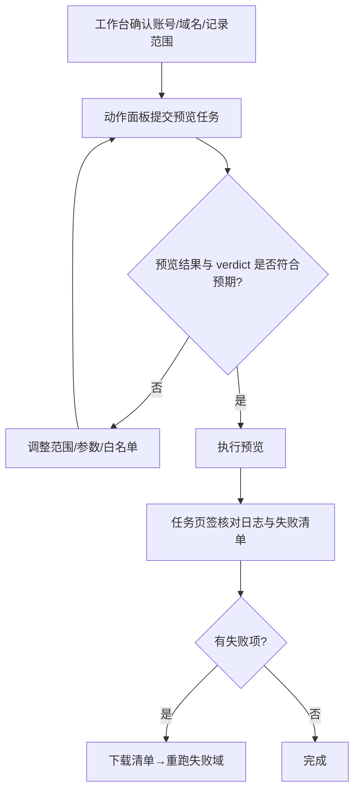

# WebUI 使用说明

## 1 打开

```powershell
.\serve-webui.ps1              # 后台启动 8600，默认 v2 单工作台
.\serve-webui.ps1 -V1          # 需要旧四页前端时启动 v1
```

浏览器访问 `http://127.0.0.1:8600`。排障看 `.\serve-webui.ps1 -Logs`；前台调试才用 `python start_web_ui.py --port 8600`。

## 2 建议顺序（v2）

1. 左侧选账号与域名，中间记录表按服务端分页加载。
2. 选中记录或点“批量操作”，在右侧填写参数并提交预览。
3. 预览面板读取任务真实结果；确认无误后执行变更。
4. 任务页签看进度、日志与失败清单；有失败域可重跑。
5. 删除类动作先限定范围；删域名必须填快照目录并输入 `DELETE`。

## 3 高风险动作

- 删除通配符 / 删 IP / 删域名必须先限定域名范围。
- 删域名必须填快照目录并输入 `DELETE`，否则 400 拒绝。
- 正式变更前建议填快照目录做自动备份；备份失败会中止变更。

## 4 全量能力对照（CLI → Web）

| CLI | Web |
|---|---|
| `-f` 查找域名 | 高级页“跨账号查找” → `GET /api/v1/find?domain=` |
| `--list-dns` | 工作台记录表 → `GET /api/v1/records`（服务端分页） |
| 单条增改 | 记录编辑器 → `PATCH /api/v1/records`；新增/导入 → `POST`；按 id 删 → `DELETE` |
| 批量更新/删除/添加/设属性/导出 | 动作面板/高级页 → `POST /api/v1/jobs`（`dry_run` 默认开） |
| `--provision` 全流程 | 动作面板或高级页 provision：服务器 IP/转发邮箱/SSL/步骤开关 → 同名模式任务 |
| 失败清单重跑 | 高级页上传清单 `POST /api/v1/resume-upload`；任务页签“重跑失败域” |
| 白名单文件 | 高级页上传 `POST /api/v1/whitelist-upload`，附加到下一次任务（等价 `-w`） |
| 域名列表导出 | 高级页“zone CSV” → `GET /api/v1/zones.csv`（UTF-8-SIG，5000 行上限） |
| 备份产物下载 | 任务页签“导出文件” → `GET /api/v1/jobs/{id}/exports[/{n}]`（仅限导出/快照目录内） |
| 显式调参 | 高级页“运行参数”：速度档位/限速范围/最大重试（账号并发越界 400） |
| 催激活 | 域名激活等待在 provision 内自动执行；也可调 `POST /api/v1/zones/activation-check` |



## 5 导航与窄屏

- 左侧账号/域名搜索框用于本地过滤，不触发额外请求。
- 390/768/980/1440 宽度可用；640 以下记录表转卡片，页面无横向滚动。
- 移动端左侧导航通过顶栏菜单按钮展开，选择后自动收起。

## 6 新前端 v2（单工作台）

`webui/v2/` 是默认单工作台前端，不再分概览/浏览/操作/任务四页：

- 左侧账号/域名导航，中间记录表，右侧操作/任务检查器。
- 记录表按服务端分页加载（50 条/页），搜索、类型、代理与排序都传后端；选中记录跨页保留。
- 选中记录或直接点“批量操作”，填写参数后先提交预览任务；预览面板读取任务真实结果，确认后“执行变更”。
- 任务页签里可看进度、原始日志、失败清单、异常 CSV、失败域重跑、执行预览、导出文件。
- 单条记录“编辑”走 `PATCH /api/v1/records`；选中记录可批量设置代理、按 ID 改内容或删除。
- 高级页已接：跨账号查找、provision 预览/执行、JSON 导入预检/写入、记录 JSON / zone CSV 导出、服务器导出任务、白名单/重跑清单上传、任务历史与审计、运行参数。

启动（与旧版对比，建议单独端口）：

```powershell
cd webui/v2
npm install
npm run build
cd ../..
python start_web_ui.py --port 8601 --config <cf_config.csv|json>
```

也可用 `.\serve-webui.ps1 -Port 8601 -Config <cf_config.csv|json>` 由后台服务管理；
`-Restart -V1` 切回旧前端，不传前端参数时 `-Restart` 保持现状。

浏览器打开 `http://127.0.0.1:8601`。旧版用 `-V1` 启动；v2 已是默认入口。
