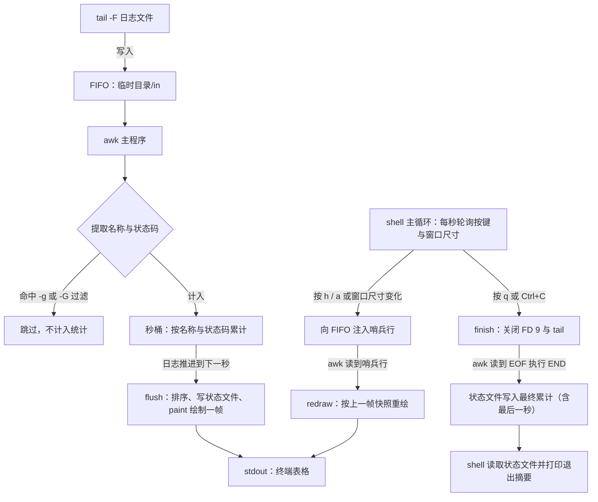

# qps.sh 使用说明（nginx 聚合日志实时 QPS 监控）

## 1. 概述

`qps.sh` 是一个只读的实时监控脚本：它以 `tail` 跟踪 nginx 聚合日志，按“秒”分桶统计各聚合维度的请求数（QPS）、与上一秒相比的增减以及响应状态码分布，并在终端中以自适应表格每秒刷新一屏；退出时打印本次监控的累计摘要。

- 输入：符合 nginx `log_format main_format_lite` 的聚合日志文件（默认 `/www/wwwlogs/spider.log`）。
- 输出：实时表格写入 stdout；启动提示、告警与错误写入 stderr。
- 边界：脚本不写入、不轮转、不修改日志文件，也不修改任何 nginx 配置；运行期只在临时目录中创建 FIFO 与控制文件，退出时删除。

## 2. 依赖与前置条件

| 依赖项 | 要求 |
|---|---|
| bash | 4.0 及以上版本（脚本使用 `read -rsn1 -t`、`BASH_REMATCH`、here-string 等特性） |
| tail | 需支持 `-F` 参数，用于按文件名跟随日志，日志轮转（改名重建）不中断监控 |
| awk | 需支持 `strftime()` 与 `systime()`（如 gawk、mawk）；脚本优先使用 `gawk`，缺失时回退 `awk` 并自检，不满足时打印错误并以退出码 2 结束 |

日志文件必须存在且可读：脚本在启动阶段检查这两项，不满足时打印错误并以退出码 2 结束，不会进入监控。

日志格式要求（对应 `nginx_conf/com_log_format.conf` 中的 `main_format_lite`）：

```text
$remote_addr [$time_local] status=$status bytes=$body_bytes_sent [$request_method] [req = $host$request_uri] UA="$http_user_agent" referer="$http_referer" CF-IPCountry: $http_cf_ipcountry
```

| 脚本读取的字段 | 日志中的位置 | 用途 |
|---|---|---|
| `time_local` | 第 2 个空白分隔字段 `[日/月/年:时:分:秒` | 秒级分桶的时间来源，回放旧日志时统计仍准确 |
| `status=NNN` | 形如 `status=200` | 归类为 2xx/3xx/4xx/5xx 列；缺失或为 0xx/1xx 时计入 `OTHER` |
| `[req = $host$request_uri]` | 形如 `[req = example.com/path?x=1]` | 聚合维度 `domain` 取 `example.com`，`uri` 取 `example.com/path`（查询串被去除） |

字段缺失时的行为：无法解析 `[req = ...]` 的行其名称记为 `unknown`；无法解析 `status=...` 的行其状态码计入 `OTHER`。脚本不会因为个别行格式异常而中断。

终端要求：交互快捷键仅在 stdin 为终端时启用。stdout 非终端（重定向或管道）时脚本仍会运行，但每帧按 `-t` 上限输出（未设上限时输出全部名称）并叠加屏幕清屏控制符，因此该方式仅用于临时取样，不建议长期重定向保存。

## 3. 快速开始

| 目的 | 命令 |
|---|---|
| 监控默认聚合日志 | `qps.sh` |
| 监控指定日志文件 | `qps.sh -f /www/wwwlogs/all.log` |
| 只关注某域名 | `qps.sh -g 'example\.com'` |
| 排除指定域名 | `qps.sh -G 'internal\.example\.com'` |
| 按“域名 + 路径”看最热路径 | `qps.sh -m uri -t 20` |
| 回放整个文件后再跟踪新增 | `qps.sh -a -f /www/wwwlogs/spider.log` |
| 不按 Top 截断，列出全部名称 | `qps.sh -x` |

## 4. 命令行选项

| 选项 | 参数 | 默认值 | 说明 |
|---|---|---|---|
| `-f` / `--file` | 文件路径 | `/www/wwwlogs/spider.log` | 监控目标；也可用位置参数给出，二者等价 |
| `-t` / `--top` | `1`–`200`、`0`、`all` | `15` | 每帧显示前 N 名；`0` 与 `all`（也接受 `ALL`、`all-rows`、`unlimited`）表示不按 Top 截断，等价于 `-x`；该值只截断显示行数，不改变统计口径 |
| `-x` / `--expand` | 无 | 关闭 | 启动即展开全部名称，等价于 `-t 0` |
| `-m` / `--mode` | `domain`、`uri` | `domain` | 聚合维度：`domain` 按域名，`uri` 按“域名/路径” |
| `-a` / `--all` | 无 | 关闭 | 从文件头回放再跟踪；不加该选项时只统计启动之后新增的行 |
| `-g` / `--grep` | 正则 | 无 | 只统计名称匹配该正则的请求 |
| `-G` / `--skip` | 正则 | 无 | 排除名称匹配该正则的请求 |
| `-h` / `--help` | 无 | — | 打印用法后以退出码 0 结束 |
| `--` | 无 | — | 结束选项解析，其后参数按位置参数处理 |

参数校验：`-t` 只接受 `1`–`200` 的整数或 `0`/`all`；`-m` 只接受 `domain`/`uri`；`-g`/`-G` 的正则在启动时预检。任一校验失败时脚本打印“错误：…”并以退出码 2 结束。

## 5. 交互快捷键

快捷键仅在 stdin 为终端时可用，且按下后立即生效，无需等待新日志。

| 按键 | 作用 |
|---|---|
| `q` / `Q` | 退出监控并打印摘要（摘要与 Ctrl+C 相同，退出码为 0） |
| `h` / `H` / `?` | 显示或隐藏帮助面板（面板固定显示在画面最上方，与标题之间隔一个空行） |
| `a` / `A` | 展开或收起被 Top 上限截断的名称 |
| `Ctrl+C` | 退出监控并打印摘要 |
| `Ctrl+D` | 关闭 stdin，按正常退出处理并打印摘要 |

`a` 的语义需要与窗口高度区分：它解除的是 `-t/--top` 的行数上限，并不保证能显示全部名称。展开后若名称数仍超过窗口可用行数，超出部分被窗口高度截断，表格中以“窗口高度不足，可放大窗口”提示。未设置 `-t` 上限时（默认的自适应模式）脚本本就铺满窗口，此时按 `a` 不改变行数。

## 6. 统计口径

| 术语 | 定义 |
|---|---|
| 名称（key） | 按 `-m` 维度聚合出的标识：`domain` 模式为域名，`uri` 模式为“域名/路径”（查询串已去除）；两种模式都把名称截断到 64 个字符，因此统计口径不随窗口宽度变化 |
| QPS | 该名称在最近一个已结束的秒内的请求数 |
| DELTA | 该名称本秒 QPS 与上一秒之差：`+` 表示上升（绿色）、`-` 表示下降（红色）、`.` 表示持平 |
| 2xx / 3xx / 4xx / 5xx | 该名称本秒内对应状态码类别的请求数 |
| OTHER | 该名称本秒内状态码为 0xx、1xx 或无法解析的请求数 |
| TOTAL(1s) | 本秒各列分别求和：请求数与各状态码类别各自合计 |
| TOTAL(ALL) | 自本次监控启动至今，各列的累计合计 |
| 平均 QPS | 总请求数除以日志时间跨度 |
| 单秒峰值 | 各秒请求数合计的最大值及其发生时刻 |
| 日志时间跨度 | 相邻两行 `time_local` 之差的累加（首行按 1 秒计）；单次差值大于或等于 7200 秒时视为时间戳乱序或日志断层，不计入 |

时间来源规则：脚本优先取日志行内的 `time_local` 秒值作为分桶时间，取不到时回退当前系统时钟。因此对旧日志执行 `-a` 回放时，统计结果仍按日志自身的时间轴呈现。

展示与统计相互独立：每帧展示的是“最近一个已结束的秒”的数据；`-t` 与 `a` 只影响屏幕上显示多少行，`TOTAL` 行、累计合计与退出摘要始终按全部通过过滤的请求计算。

过滤口径：`-g` 与 `-G` 匹配的是聚合后的名称而非原始日志行，因此按路径过滤需配合 `-m uri`；被过滤掉的请求不进入任何统计（包括 `TOTAL` 与摘要）。

## 7. 显示与自适应规则

数据行数在终端中共有三档取值，窗口高度始终是上限：

| 情形 | 数据行数 |
|---|---|
| 已展开（`-x`、`-t 0`/`all`，或按过 `a`） | 取“名称数”与“窗口可用行数”的较小值，尽量铺满窗口 |
| 未展开且显式给出 `-t N` | 取 N 与“窗口可用行数”的较小值 |
| 未展开且未给出 `-t`（默认） | 窗口可用行数，随窗口高度自适应 |

窗口可用行数 = 窗口行数 − 固定开销。固定开销包含标题 1 行、表头 1 行、合计 2 行、页脚 1 行、末尾空行 1 行、省略提示预留 1 行与抗滚屏余量 1 行；标题和页脚在窄窗口下自身折行时按其实际行数计算，帮助面板展开时再按其占用行数叠加。

列集合按可用宽度由多到少退让，判据是本帧实际要显示的名称长度 `need`（下限 16，上限 64）：

| 条件（`need` = 本帧最长名称宽度） | 显示列 |
|---|---|
| 宽度 ≥ `need` + 47 | 完整：KEY + QPS + DELTA + 2xx/3xx/4xx/5xx + OTHER |
| 宽度 ≥ `need` + 40 | 隐去 OTHER |
| 宽度 ≥ `need` + 32 | 再隐去 DELTA |
| 宽度 ≥ 24 | 仅 KEY + QPS，名称过长时按宽度截断 |
| 宽度 < 24 | 仅 `TOTAL(1s)` 与 `TOTAL(ALL)` 两行 |

表格中的名称因列宽不足被截断时，保留名称尾部的“..”标记（域名尾部、路径深部更具辨识度）；KEY 列宽度上限为 80 列。帮助面板在窗口过窄时自动改用紧凑文案；窗口高度不足时面板按可放下部分逐行显示，并优先保留面板与标题之间的空行。

重绘时机有三类：日志推进到下一秒、按下快捷键、窗口尺寸变化。窗口尺寸由脚本每秒轮询一次（`stty size`，无终端时回退 `LINES`/`COLUMNS`，再回退 `24x80`；行数小于 5 或列数小于 20 视为无效尺寸），不依赖 `SIGWINCH`。无流量的空闲期间表格停留在最后一帧，不会清空；恢复流量后若间隔超过 1 秒，标题下方会出现“（间隔 N 秒无请求）”提示。

## 8. 运行机制



上图说明数据与退出两条路径：日志行经 `tail` 写入 FIFO，由 `awk` 逐行提取名称与状态码并累积到秒桶，日志推进到下一秒时冲刷该桶并绘制一帧；shell 侧主循环只负责读按键与轮询窗口尺寸，需要立即重绘时向 FIFO 写入哨兵行，`awk` 读到哨兵行即按上一帧快照重绘，因此空闲时也能响应按键与改窗口。

退出路径的顺序是固定的：先关闭 shell 持有的 FIFO 写端（文件描述符 9），再停止 `tail`，此时 `awk` 读到 EOF 并执行 `END`，把包含最后一秒的累计值写入状态文件；shell 随后读取该状态文件打印摘要。`awk` 收到中断信号时不会执行 `END`，因此脚本在监控过程中每秒（以及每处理 500 行）就把累计指标写入状态文件，正常退出则以 `END` 写入的最终值覆盖。

运行期临时文件位于 `mktemp -d` 创建的目录中（通常形如 `/tmp/qps.XXXXXX`），退出时由 `EXIT` trap 整体删除：

| 文件 | 用途 |
|---|---|
| `in` | FIFO，承载 `tail` 的日志行与 shell 注入的重绘哨兵行 |
| `ctrl` | 快捷键状态（`help=0|1 expand=0|1`），`awk` 每帧读取 |
| `size` | 当前终端尺寸（`行 列`），`awk` 每帧读取；窗口变化时 shell 更新 |
| `stat` | 累计指标（制表符分隔），供退出摘要读取 |

## 9. 退出摘要与退出码

退出摘要依次打印：起止时刻与总请求数、平均 QPS 与单秒峰值（含发生时刻）、状态码合计（2xx/3xx/4xx/5xx/其他/合计）。窗口宽度小于 60 列时，状态码合计自动拆为两行，避免终端硬折行。

| 退出码 | 触发条件 |
|---|---|
| 0 | 按 `q`/`Q` 退出，或 stdin 关闭（Ctrl+D）后正常收尾 |
| 130 | 收到 Ctrl+C（`SIGINT`）或 `SIGTERM` 后由 `finish 130` 收尾 |
| 2 | 参数错误、日志文件不存在或不可读、`awk` 不支持 `strftime`/`systime`、正则非法、FIFO 创建失败 |
| 其他 | 非交互模式下 `awk` 提前退出时，其退出状态经 `wait` 原样传出 |

## 10. 常见问题

| 现象 | 原因 | 处理 |
|---|---|---|
| 画面停在“已启动，等待日志行…” | 默认只统计启动后新增的行，而日志暂无写入 | 确认日志正在写入；需要统计已有内容时加 `-a` 回放 |
| 启动时提示“日志最后写入于 N 秒前” | 日志处于无流量或已轮转状态 | 属提示信息；确认业务流量或日志轮转配置后继续等待 |
| 报错“当前 awk 不支持 strftime/systime” | 系统 `awk` 为 BWK awk（macOS 自带）等不支持时间函数的实现 | 安装 `gawk` 后重试 |
| 表格底部提示“窗口高度不足，可放大窗口” | 名称数超过窗口可用行数 | 放大终端窗口；若提示来自 `-t` 上限则应先按 `a` 展开 |
| 表格底部提示“按 a 展开” | 当前限制来自 `-t` 上限而非窗口高度 | 按 `a` 展开全部名称 |
| 表格只显示 `TOTAL(1s)` 与 `TOTAL(ALL)` | 窗口宽度不足 24 列 | 放大终端窗口宽度 |
| 重定向到文件后内容看似杂乱 | 非终端输出时每帧都带清屏控制符，且逐帧追加 | 改为在终端（或 tmux/screen）中运行；确需取样时只保留短时间输出 |
| 按 `q` 无响应 | stdin 不是终端（例如被重定向或在无终端的后台会话中运行） | 用 `Ctrl+C` 结束，或改在交互式终端中启动 |

## 11. 维护与检查

代码改动后的检查命令（在脚本所在目录执行）：

```bash
bash -n qps.sh                     # 语法检查
shellcheck -x qps.sh               # 静态检查，应无输出
shfmt -i 4 -ci -d qps.sh           # 格式检查，应无输出
shfmt -i 4 -ci -w qps.sh           # 需要规范化格式时写回
```

说明：格式基线为 4 空格缩进并对 `case` 分支体缩进（`-i 4 -ci`）；脚本使用 LF 换行；`awk` 程序以单引号内嵌，其中的 `$0`/`$1` 由 `awk` 解释，脚本已就 SC2016 屏蔽对应告警。

与日志格式的耦合点集中在 `awk` 主程序的字段解析段落（`time_local`、`status=`、`[req = ...]`）与第 2 节的字段对应表。修改 nginx 日志格式时，必须同步检查这两处；否则名称会退化为 `unknown`，状态码列会全部落入 `OTHER`。
