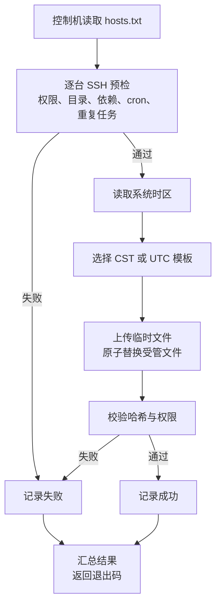

# 多服务器定时任务批量下发方案

## 背景与目标

假设有多台 Linux 服务器，每台已经维护了多条 crontab 任务。现在需要新增或更新一组每天执行的任务，并希望在不动存量条目的前提下批量维护。

本方案把这组任务收敛到一份**受管 cron 文件**（默认 `/etc/cron.d/update-cron`），任务内容由模板决定，可以是站点更新、备份、清理、同步等任意 cron 任务。仓库内的 `cron.cst` 与 `cron.utc` 是示例模板，内容为两条 WP 函数更新任务，见文末“示例：两条 WP 函数更新任务”。

本方案的目标如下：

- 在不改动现有 crontab 条目的前提下，为多台服务器新增或更新一组任务。
- 通过一条命令批量下发，重复执行得到一致结果，即幂等。
- 支持下发前预演、下发后校验、备份回滚和整体删除。
- 不改变目标机的系统时区，避免影响已有任务和其他依赖本地时间的程序。

本方案不承担以下职责：

- 不负责部署任务依赖的脚本与数据文件；需要预检时用 `--require` 声明。
- 不接管目标机已有的 crontab 条目。
- 不提供 Web 控制台、集中调度和高可用能力。
- 不为观察夏令时的时区提供季节自动换算，边界见后文。

## 术语

| 术语 | 含义 |
| --- | --- |
| 控制机 | 执行 `deploy.sh` 的机器，通常是运维人员的笔记本或跳板机 |
| 目标机 | 主机清单中的每一台服务器 |
| 受管文件 | 目标机上的 `/etc/cron.d/update-cron`（可用 `--target` 改），由本方案创建、覆盖和删除 |
| 模板 | 控制机上承载任务内容的 cron 文件，下发后成为受管文件 |
| 服务端安装器 | 目标机上的 `install-cron.sh`，负责把上传的模板落地为受管文件 |
| 批量推送命令 | 控制机上的 PowerShell 函数 `Push-FileToServers`，负责上传、按指定权限与属主落地、原子替换、备份与写后校验 |
| 幂等 | 同一份配置重复下发，目标机最终状态一致，不产生重复任务 |

## 现状与约束

目标机已经存在大量 crontab 条目，这决定了方案不能采用“取出整张表、修改后整体写回”的做法。`crontab -l > tmp && 修改 tmp && crontab tmp` 这类写法会在管道失败、并发编辑或面板改写时丢失条目，排查成本高。

目标机同时可能安装了宝塔面板。宝塔面板通常维护 root 用户的 crontab，不会读取或改写 `/etc/cron.d`，因此把新任务放到独立文件中，可以与面板和人工维护的条目保持隔离。

如果目标机的 root crontab、`/etc/crontab` 或其他 `/etc/cron.d` 文件中已经存在相同任务的条目，应先备份并删除旧条目，再执行本方案。两个脚本都会从模板中提取 `.php` 与 `.sh` 的基名，在其他 cron 配置中查找同名引用，命中时拒绝下发或写入，避免同一任务每天执行两次。

本方案只依赖 OpenSSH、cron 和基础 coreutils，不引入 Ansible、systemd timer 或集中调度平台。对于几十台服务器和少量固定任务，这些组件带来的收益小于新增的维护成本。

## 方案对比

| 方案 | 对现有 crontab 的影响 | 批量能力 | 幂等 | 额外依赖 | 结论 |
| --- | --- | --- | --- | --- | --- |
| 逐台执行 `crontab -e` | 追加条目，但需要人工逐台操作 | 无 | 难以保证 | 无 | 只适合临时处理 |
| `crontab -l` 过滤后整体安装 | 重写整张表，异常时可能丢失条目 | 有 | 可以实现 | 无 | 风险高于收益，不采用 |
| `/etc/cron.d` 独立文件 + SSH 下发 | 不修改现有条目 | 有 | 有 | OpenSSH | **本方案采用** |
| `/etc/cron.d` 独立文件 + PowerShell 批量推送 | 不修改现有条目 | 有 | 有 | OpenSSH + PowerShell | 控制机无 Bash 时的落地方式，预检弱于 `deploy.sh` |
| Ansible `cron` 模块 | 可写独立文件或用户表 | 有 | 有 | Ansible | 对少量机器偏重 |
| systemd timer | 不涉及 crontab | 有 | 有 | systemd | 每个任务需要 service 与 timer 两个单元文件，超出多数需求 |

## 选定方案

在每台目标机维护一份受管文件，默认 `/etc/cron.d/update-cron`，文件内容就是模板中的全部任务。`deploy.sh` 从 `hosts.txt` 读取目标机，逐台通过 SSH 完成预检、上传、原子替换和校验。控制机侧另有面向无 Bash 环境的两种落地方式；三者写同一个受管路径、共用同一份自己的模板，差别在预检覆盖范围与幂等比对的位置，见“统一时区下的简化形态”。



流程的关键点是：预检在写入前完成，写入采用“临时文件 + 同目录改名”的原子替换，写入后再比对哈希和权限。任何一台失败不会中断其余目标机，脚本最后按失败数量返回退出码。

### 统一时区下的简化形态

当全部目标机使用同一系统时区（典型情况是都是 `Asia/Shanghai`）时，不必按机器选择模板，只需维护一份自己的模板（可从仓库内的 `cron.cst` 复制到仓库外）。此时控制机侧有三种落地方式，写入的是同一个受管路径，验收标准也一致：

| 落地方式 | 控制机依赖 | 预检与幂等比对 | 适用场景 |
| --- | --- | --- | --- |
| `deploy.sh` | Bash、OpenSSH | 写入前预检权限、目标目录、`--require` 依赖、cron 服务与重复任务；在控制机比对哈希与权限后才上传 | 时区混合，或需要完整预检 |
| `scp` + `install-cron.sh` | OpenSSH，不需要 Bash | 上传后在目标机比对哈希与权限，检查重复条目，并对 cron 服务未运行给出警告；不检查 `--require` 依赖 | 未加载 `PS/WpOnline` 模块，或需要在目标机单独校验与删除 |
| `Push-FileToServers` | OpenSSH、PowerShell，加载仓库 `PS/WpOnline` 模块 | 上传后在目标机比对哈希与权限；**不做**依赖、cron 服务与重复任务检查 | 控制机为 Windows、目标机时区统一，且旧条目已清理 |

三种方式都做去 BOM、去 CR、原子替换、按需备份与写后校验，重复执行都幂等。选择依据是控制机环境与是否需要预检，与任务内容无关。`Push-FileToServers` 也可以只承担上传：把落点改为 `/tmp`，安装仍由 `install-cron.sh` 完成，这属于第二种方式的写法变体，不另算一种。

`Push-FileToServers` 直接落到受管路径时只负责文件落地，不承担业务预检：首次迁移前的重复条目清理、依赖文件是否就绪，必须按 README“已有相同任务时的迁移”单独确认。它的备份目录默认是 `/var/backups`，需要与 `install-cron.sh` 的回滚路径一致时显式传 `-BackupDirectory /var/backups/update-cron`。

## 为什么使用 /etc/cron.d

`/etc/cron.d` 使用与用户 crontab 相同的五字段语法，只是在命令前多一个运行用户字段。它适合存放由配置管理工具维护的系统级任务，原因如下：

- 一个任务组一个文件，新增、覆盖和删除都不会触碰其他条目。
- 文件可以整份替换，内容与模板一一对应，便于校验和回滚。
- cron 每分钟扫描一次配置，文件变更通常下一分钟生效，不需要重启服务。
- 宝塔面板和人工执行的 `crontab -e` 通常不会改写这个目录，减少互相覆盖的概率。

受管文件名不含点号。Debian 系要求 `/etc/cron.d` 中的文件名只包含字母、数字、下划线和连字符，带点号的文件会被忽略；两个脚本都会在写入前拒绝这类名称。

## 时区策略

cron 的触发时刻按目标机的系统时区解释。模板中的 `TZ=Asia/Shanghai` 只影响任务进程看到的时区，不会改变触发时刻。因此需要两份模板；仓库内提供了两份示例：

| 示例模板 | 适用系统时区 | 示例任务时刻 |
| --- | --- | --- |
| `cron.cst` | `Asia/Shanghai` | 北京时间 16:00 与 00:00 |
| `cron.utc` | `UTC` | UTC 08:00 与 16:00，对应北京时间相同 |

实际下发用自己在仓库外维护的副本，模板中的任务、依赖脚本和日志路径按真实环境填写。

`deploy.sh` 会自动读取目标机的 `timedatectl` 时区并选择模板。其他固定 UTC+8 时区（例如 `Asia/Singapore`、`Asia/Hong_Kong`）可以用 `--template` 指向自己的 CST 模板；观察夏令时的时区不能靠固定小时同时满足全年北京时间，这类环境应改用带时区的 systemd timer，或接受季节性偏移。

本方案**不修改系统时区**。已有大量 crontab 条目的服务器切换系统时区，会让这些条目的绝对触发时刻整体平移，风险远高于本次需求。

`TZ=Asia/Shanghai` 还解决了零点任务的日期问题：北京时间 00:00 在 UTC 机器上是前一天 16:00，如果进程没有设置 `TZ`，脚本里的 `date +%F` 会得到前一天，按日期生成的文件名或判断都会错位。

## 幂等、备份与回滚

`deploy.sh` 在写入前读取目标文件的 SHA-256 和权限。内容与权限都符合预期时，脚本跳过该目标机，不产生多余写入和备份。

`Push-FileToServers` 采用同一套判据，只是位置不同：先 `scp` 上传到 `/tmp`，再在同一个 SSH 会话内比对目标文件的 SHA-256 与权限，一致即跳过写入并删除临时文件，因此重复执行同样不产生多余备份。备份文件名与 `install-cron.sh` 一致，都是 `<受管文件名>.<时间戳>`，但默认目录是 `/var/backups`；要保持与下文的回滚路径一致，下发时显式传 `-BackupDirectory /var/backups/update-cron`。

`deploy.sh` 需要更新时，在目标机执行以下动作：

- 将旧文件复制到 `/var/backups/<受管文件名>/<受管文件名>.<时间戳>`。
- 将新内容安装为受管路径旁的临时文件 `<受管路径>.tmp.<进程号>`。
- 在同一目录内改名为受管路径，避免 cron 读到半截文件。
- 在启用 SELinux 的系统上执行 `restorecon`，修正文件安全上下文。

`Push-FileToServers` 走同一模式，只是临时文件建在目标路径旁（`<受管路径>.tmp`），改名后回显最终哈希与权限，供调用方核对。

回滚时，将备份文件复制回受管路径即可：

```bash
cp -p /var/backups/update-cron/update-cron.20261028-160000 /etc/cron.d/update-cron
```

在启用 SELinux 的系统上，复制后执行 `restorecon -F /etc/cron.d/update-cron` 修正安全上下文。

执行 `--remove` 时，脚本会先备份为 `<受管文件名>.removed.<时间戳>`，再删除受管文件。删除后 cron 在下一分钟停止调度其中的任务，已有 crontab 条目不受影响。

## 预检与重复任务

`deploy.sh` 在写入前逐台检查：

- 以 root 登录，目标目录存在。
- 目标机具备 `install`、`mktemp`、`sha256sum`、`stat`、`base64`。
- `--require` 声明的依赖文件存在；该选项可重复，适合声明任务需要的数据源或更新脚本。
- cron 服务处于运行状态。
- root crontab、`/etc/crontab` 与其他 `/etc/cron.d` 文件中没有引用模板内 `.php`、`.sh` 同名脚本的条目。

`install-cron.sh` 在写入前做同样的重复条目检查，并对 cron 服务未运行给出警告；依赖文件由调用方保证。`Push-FileToServers` 只做文件落地，以上检查都不执行。

## 失败处理

`deploy.sh` 按目标机逐台处理，单台失败不会中断整批任务，最后输出成功与失败数量，并以非零状态退出。`Push-FileToServers` 同样逐台处理单台失败，但只用结果对象与警告报告，不设置退出码。失败原因会直接打印，常见类型如下：

- SSH 无法连接，或密钥认证失败。
- 登录用户不是 root，无法写入受管路径。
- `--require` 声明的依赖文件缺失。
- cron 服务未运行，任务不会被调度。
- root crontab、`/etc/crontab` 或其他 `/etc/cron.d` 文件中已有相同任务的条目。
- 系统时区不在自动识别范围内，需要显式指定模板。
- 远端命令解析失败，报 `syntax error: unexpected end of file` 或 `parse error near ...`。这类错误说明下发的命令换行或引号已被破坏：CR 不被远端 shell 当作空白字符，`then`、`fi`、`}` 等标记退化为普通词，报错位置往往落在脚本末尾。`Push-FileToServers` 已按 LF 与单引号构造远端命令（只使用单引号，不含双引号），若仍出现该报错，应先确认调用的是最新版本；此时受管文件尚未写入，上传到 `/tmp` 的临时文件可能残留，用 `rm -f /tmp/push-file-*` 清理。
- `Push-FileToServers` 报 `Failed 上传失败`：`scp` 阶段未完成，常见原因是 host key 未接受、密钥未授权或网络不可达，按前两条处理。
- `Push-FileToServers` 报 `Failed 写入失败`：目标目录不存在或权限不足，首次下发加 `-CreateDirectory`，并确认以 root 登录。
- `Push-FileToServers` 报 `Failed 作业异常`：后台作业未正常返回结果，通常是本机 PowerShell 版本或模块路径问题，改用 `-ThrottleLimit 1` 顺序执行可绕开并发层。

## 验收标准

一次成功下发应同时满足以下条件：

- 目标机的 `crontab -l` 中不存在相同任务的旧副本，其余条目与下发前一致。
- 受管文件存在，权限为 `644`，属主和属组均为 `root`。
- 文件内容与对应模板一致，包含模板中的全部任务。
- `--check` 对全部目标机返回成功；用 `Push-FileToServers` 下发时，重复执行同一条命令对全部目标机显示 `Skipped`。
- 到达任务预定时间后，cron 日志出现对应记录，任务日志有新增内容。
- 宝塔面板和 `crontab -l` 中没有重复的相同任务。

## 风险与边界

本方案假定控制机可以通过 SSH 以 root 身份登录目标机，并且目标机已经安装并运行 cron。`deploy.sh` 需要控制机具备 Bash；只有 Windows PowerShell 时改走 `Push-FileToServers`，但该方式不做业务预检，重复条目与依赖文件仍需人工确认。若实际环境使用普通用户加免密 `sudo`，需要修改 `deploy.sh` 中的远程执行部分。

任务日志由模板中的重定向决定，脚本不做轮转。长期运行时应当为该文件配置 `logrotate`，或定期清理。

仓库内的两份模板是通用示例。真实下发的模板与 `hosts.txt` 都应放在仓库外维护，避免把服务器地址、依赖脚本路径与日志路径提交到公开仓库。

cron 对时钟跳变和夏令时的处理随实现而异。本方案只覆盖固定时区，不承诺在观察夏令时的目标机上全年保持北京时间。

## 示例：两条 WP 函数更新任务

仓库内的 `cron.cst` 与 `cron.utc` 附带一组具体例子，演示同一份任务在两种系统时区下的写法：

| 任务 | 北京时间 | 命令 |
| --- | --- | --- |
| functions4 更新 | 每天 16:00 | `/bin/bash /www/sh/wp-functions-update/update_wp_functions.sh --src /www/functions4.php` |
| functions24 更新 | 每天 00:00 | `/bin/bash /www/sh/wp-functions-update/update_wp_functions.sh --src /www/functions24.php` |

两条任务都写入 `/var/log/wp-functions-update.log`。下发这组任务时，依赖预检可以写成：

```bash
bash deploy.sh --template ~/wpfc/wp-functions.cron \
  --require /www/sh/wp-functions-update/update_wp_functions.sh \
  --require /www/functions4.php \
  --require /www/functions24.php
```

重复条目检查会命中 `update_wp_functions.sh`、`functions4.php`、`functions24.php` 这三个基名。示例任务会修改站点主题目录下的 `functions.php`，首次执行前应确认目标机允许这样操作。
