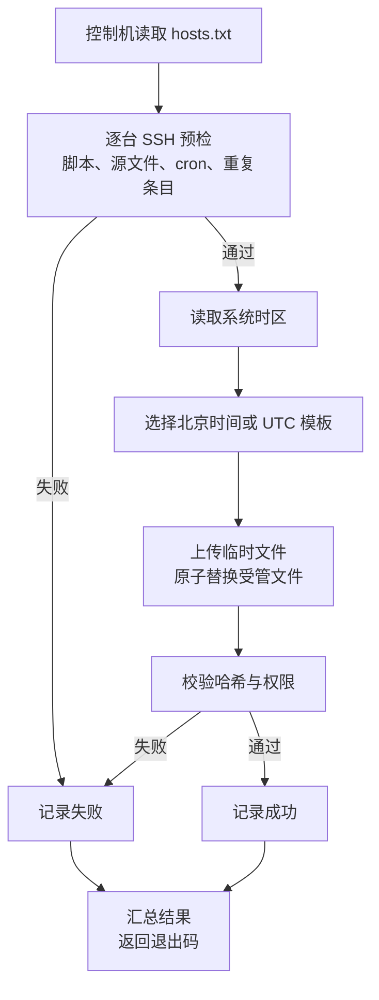

# 多服务器 crontab 批量更新方案

## 背景与目标

假设现有 10 台 Linux 服务器，每台已经维护了多条 crontab 任务。需要为每台服务器新增两条每天执行的任务：

| 任务 | 北京时间 | 命令 |
| --- | --- | --- |
| functions4 更新 | 每天 16:00 | `/bin/bash /www/sh/wp-functions-update/update_wp_functions.sh --src /www/functions4.php` |
| functions24 更新 | 每天 00:00 | `/bin/bash /www/sh/wp-functions-update/update_wp_functions.sh --src /www/functions24.php` |

本方案的核心约束是**不改动现有 crontab 条目，也不修改系统时区**。

本方案的目标如下：

- 在不改动现有 crontab 条目的前提下，为 10 台服务器新增或更新上述两条任务。
- 通过一条命令批量下发，重复执行得到一致结果，即幂等。
- 支持下发前预演、下发后校验、备份回滚和整体删除。
- 不改变目标机的系统时区，避免影响已有任务和其他依赖本地时间的程序。

本方案不承担以下职责：

- 不负责把 `update_wp_functions.sh` 部署到目标机。
- 不接管目标机已有的 crontab 条目。
- 不提供 Web 控制台、集中调度和高可用能力。
- 不为观察夏令时的时区提供季节自动换算，边界见后文。

## 术语

| 术语 | 含义 |
| --- | --- |
| 控制机 | 执行 `deploy.sh` 的机器，通常是运维人员的笔记本或跳板机 |
| 目标机 | 主机清单中的每一台服务器 |
| 受管文件 | 目标机上的 `/etc/cron.d/wp-functions`，由 `deploy.sh` 创建、覆盖和删除 |
| 服务端安装器 | 目标机上的 `install-cron.sh`，负责把上传的模板落地为受管文件 |
| 幂等 | 同一份配置重复下发，目标机最终状态一致，不产生重复任务 |

## 现状与约束

目标机已经存在大量 crontab 条目，这决定了方案不能采用“取出整张表、修改后整体写回”的做法。`crontab -l > tmp && 修改 tmp && crontab tmp` 这类写法会在管道失败、并发编辑或面板改写时丢失条目，排查成本高。

目标机同时可能安装了宝塔面板。宝塔面板通常维护 root 用户的 crontab，不会读取或改写 `/etc/cron.d`，因此把新任务放到独立文件中，可以与面板和人工维护的条目保持隔离。

如果目标机的 root crontab、`/etc/crontab` 或其他 `/etc/cron.d` 文件中已经存在引用 `functions4.php` 或 `functions24.php` 的条目，应先备份并删除旧条目，再执行本方案。`deploy.sh` 默认会拒绝这种重复状态，避免同一任务每天执行两次。

本方案只依赖 OpenSSH、cron 和基础 coreutils，不引入 Ansible、systemd timer 或集中调度平台。对于 10 台服务器和两条固定任务，这些组件带来的收益小于新增的维护成本。

## 方案对比

| 方案 | 对现有 crontab 的影响 | 批量能力 | 幂等 | 额外依赖 | 结论 |
| --- | --- | --- | --- | --- | --- |
| 逐台执行 `crontab -e` | 追加条目，但需要人工逐台操作 | 无 | 难以保证 | 无 | 只适合临时处理 |
| `crontab -l` 过滤后整体安装 | 重写整张表，异常时可能丢失条目 | 有 | 可以实现 | 无 | 风险高于收益，不采用 |
| `/etc/cron.d` 独立文件 + SSH 下发 | 不修改现有条目 | 有 | 有 | OpenSSH | **本方案采用** |
| Ansible `cron` 模块 | 可写独立文件或用户表 | 有 | 有 | Ansible | 对 10 台机器偏重 |
| systemd timer | 不涉及 crontab | 有 | 有 | systemd | 每个任务需要 service 与 timer 两个单元文件，超出本次需求 |

## 选定方案

在每台目标机新增一个受管文件 `/etc/cron.d/wp-functions`，文件内容就是两条标准 crontab 条目。`deploy.sh` 从 `hosts.txt` 读取目标机，逐台通过 SSH 完成预检、上传、原子替换和校验。



流程的关键点是：预检在写入前完成，写入采用“临时文件 + 同目录改名”的原子替换，写入后再比对哈希和权限。任何一台失败不会中断其余目标机，脚本最后按失败数量返回退出码。

### 统一时区下的简化形态

当全部目标机使用同一系统时区（典型情况是都是 `Asia/Shanghai`）时，不必按机器选择模板，只需维护一份 cron 文件。对已经具备 Windows 批量 SSH 与 `scp` 能力的运维环境，可以把下发拆成两步：

- 控制机把模板上传到目标机的 `/tmp`；
- 目标机执行 `install-cron.sh`，由它在本地完成去 BOM、去 CR、备份、原子替换、写后校验和重复条目检查。

两种形态共用同一份模板和同一套验收标准，区别只在于幂等比对发生的位置：`deploy.sh` 在控制机比对后决定是否上传，`install-cron.sh` 在目标机比对后决定是否写入。选择依据是时区是否同构，以及控制机是否有 Bash 环境，与任务内容无关。

## 为什么使用 /etc/cron.d

`/etc/cron.d` 使用与用户 crontab 相同的五字段语法，只是在命令前多一个运行用户字段。它适合存放由配置管理工具维护的系统级任务，原因如下：

- 一个任务组一个文件，新增、覆盖和删除都不会触碰其他条目。
- 文件可以整份替换，内容与模板一一对应，便于校验和回滚。
- cron 每分钟扫描一次配置，文件变更通常下一分钟生效，不需要重启服务。
- 宝塔面板和人工执行的 `crontab -e` 通常不会改写这个目录，减少互相覆盖的概率。

文件名 `wp-functions` 不含点号。Debian 系要求 `/etc/cron.d` 中的文件名只包含字母、数字、下划线和连字符，带点号的文件会被忽略。

## 时区策略

cron 的触发时刻按目标机的系统时区解释。受管文件中的 `TZ=Asia/Shanghai` 只影响任务进程看到的时区，不会改变触发时刻。因此模板分为两份：

| 模板 | 适用系统时区 | 16:00 任务 | 00:00 任务 |
| --- | --- | --- | --- |
| `wp-functions.cron.cst` | `Asia/Shanghai` | `0 16` | `0 0` |
| `wp-functions.cron.utc` | `UTC` | `0 8` | `0 16` |

`deploy.sh` 会自动读取目标机的 `timedatectl` 时区并选择模板。其他固定 UTC+8 时区（例如 `Asia/Singapore`、`Asia/Hong_Kong`）可以通过 `--template wp-functions.cron.cst` 指定；观察夏令时的时区不能靠固定小时同时满足全年北京时间，这类环境应改用带时区的 systemd timer，或接受季节性偏移。

本方案**不修改系统时区**。已有大量 crontab 条目的服务器切换系统时区，会让这些条目的绝对触发时刻整体平移，风险远高于本次需求。

`TZ=Asia/Shanghai` 还解决了零点任务的日期问题：北京时间 00:00 在 UTC 机器上是前一天 16:00，如果进程没有设置 `TZ`，脚本里的 `date +%F` 会得到前一天，按日期生成的文件名或判断都会错位。

## 幂等、备份与回滚

`deploy.sh` 在写入前读取目标文件的 SHA-256 和权限。内容与权限都符合预期时，脚本跳过该目标机，不产生多余写入和备份。

需要更新时，脚本先在目标机执行以下动作：

- 将旧文件复制到 `/var/backups/wp-functions-cron/wp-functions.<时间戳>`。
- 将新内容安装为 `/etc/cron.d/.wp-functions.tmp.<进程号>`。
- 在同一目录内改名为 `/etc/cron.d/wp-functions`，避免 cron 读到半截文件。
- 在启用 SELinux 的系统上执行 `restorecon`，修正文件安全上下文。

回滚时，将备份文件复制回受管文件路径即可：

```bash
cp -p /var/backups/wp-functions-cron/wp-functions.20261028-160000 /etc/cron.d/wp-functions
```

在启用 SELinux 的系统上，复制后执行 `restorecon -F /etc/cron.d/wp-functions` 修正安全上下文。

执行 `--remove` 时，脚本会先备份为 `wp-functions.removed.<时间戳>`，再删除受管文件。删除后 cron 在下一分钟停止调度这两条任务，已有 crontab 条目不受影响。

## 失败处理

脚本按目标机逐台处理，单台失败不会中断整批任务，最后输出成功与失败数量，并以非零状态退出。失败原因会直接打印，常见类型如下：

- SSH 无法连接，或密钥认证失败。
- 登录用户不是 root，无法写入 `/etc/cron.d`。
- 目标机缺少 `update_wp_functions.sh`、`/www/functions4.php` 或 `/www/functions24.php`。
- cron 服务未运行，任务不会被调度。
- root crontab、`/etc/crontab` 或其他 `/etc/cron.d` 文件中已有引用这两个源文件的条目。
- 系统时区不在自动识别范围内，需要显式指定模板。

## 验收标准

一次成功下发应同时满足以下条件：

- 目标机的 `crontab -l` 中不存在这两条任务的旧副本，其余条目与下发前一致。
- `/etc/cron.d/wp-functions` 存在，权限为 `644`，属主和属组均为 `root`。
- 文件内容与对应模板一致，包含两条任务。
- `--check` 对全部目标机返回成功。
- 到达北京时间 16:00 或 00:00 后，cron 日志出现对应记录，`/var/log/wp-functions-update.log` 有新增内容。
- 宝塔面板和 `crontab -l` 中没有重复的同名任务。

## 风险与边界

本方案假定控制机可以通过 SSH 以 root 身份登录目标机，并且目标机已经安装并运行 cron。若实际环境使用普通用户加免密 `sudo`，需要修改 `deploy.sh` 中的远程执行部分。

受管文件中的任务会写入 `/var/log/wp-functions-update.log`，脚本不负责日志轮转。长期运行时应当为该文件配置 `logrotate`，或定期清理。

cron 对时钟跳变和夏令时的处理随实现而异。本方案只覆盖固定时区，不承诺在观察夏令时的目标机上全年保持北京时间。
